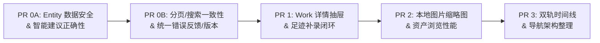

# Looma v0.5 实施规划与风险清单（基于 GPT 第二轮决议）

> **基准提交：** `0cb44b418ce11902e130f6caf5319f10ead4bd38`  
> **文档性质：** 正式开发执行前的最终方案规范、PR 拆分细则与风险防范清单。  
> **状态：** 规划完成，等待确认后按 PR 0A → PR 0B → PR 1 → PR 2 → PR 3 顺序单步推进。  
> **底线约束：** 绝不修改原有历史 Migration（`001~004`）；测试不得移动或损坏真实资产；每个 PR 独立交付并附带复现用例、自动化测试与真实 UI 场景验收。

---

## 一、五大技术修正深度设计方案

### 1. Entity 类型安全（彻底消除 JSON 字符串化与擦除风险）

#### 核心问题溯源
在 `EntitiesView.tsx:138-176` 中，通用实体编辑器把所有属性通过 `JSON.stringify` 展平为文本，保存时直接 `propertiesObj[k] = v.trim()` 以普通 string 覆盖。这导致 Work 实体的 `properties.work` 结构化对象退化为 string 标量，造成 Rust 端 `as_work_metadata()` 反序列化报错，丢失 progress、aliases、cover 等所有深层数据。

#### 修正后的深度方案
1. **禁止任意字符串“嗅探反解”（No Sniffing JSON.parse）：** 严禁采用“只要字符串看起来像 `{` 或 `[` 就自动 parse”的不可靠启发式。
2. **系统保留字段白名单与读写隔离：**
   - 明确保留键清单：`work`、`domain`、`status`、`work_type`、`progress`、`aliases`、`cover_asset_id`。
   - 通用实体编辑器（`EntitiesView.tsx`）将这些保留字段标记为**系统保留与只读展示**，禁止在动态属性键值行中随意编辑或删除。
   - 系统保留字段**必须由专用业务 API**（`update_work`、`update_work_status`、`update_work_progress`、`set_aliases` 等）更新。
3. **普通自定义属性保持真实 JSON 类型：**
   - 表单项明确区分类型：`string`、`number`、`boolean`、`json_raw`。用户输入普通数值保持 number，输入布尔保持 boolean，编辑时完整保留原有 JSON 树状结构。
4. **Rust 后端实体更新守卫（Backend Schema Guard）：**
   - 在 `facade.rs` 的 `update_entity` 中实施类型校验：若待更新实体为 Work 实体（或数据库现有记录为 Work 实体）：
     - 校验传入的 `properties.work`：若存在，必须能合法反序列化为 `WorkMetadata`；
     - 若传入的 `properties` 未包含 `work` 键（例如通用编辑器仅提交了用户自定义扩展属性），后端自动继承原有数据库中的 `work` 结构，绝不允许将对象覆盖为 string 或 null；
     - 若传入非法类型（如 `"work": "string"`），返回 `LoomaError::Validation` 明确拒绝并中止事务。
5. **回归测试（Automated Regression Test）：**
   - 编写 `crates/database/tests/entity_work_preservation_test.rs`：
     - Case 1: 创建含复杂 `WorkMetadata`（进度 chapter 5、封面 asset_id、多别名）的游戏；
     - Case 2: 通过 `update_entity` 仅修改该实体的 `title`、`description` 及新增自定义属性 `favorite_tag: "rpg"`；
     - Case 3: 验证重新获取的 `WorkSummary` 中，`progress`、`aliases`、`cover_asset_id` 100% 完好无损，且 `favorite_tag` 正确写入。

---

### 2. Assets 与 Search 全链路协同（拒绝孤岛分页）

#### 核心问题溯源
`App.tsx` 之前在根级别拉取所有 `assets` 放入 React 状态，并传给 `AssetsView` 和 `GlobalSearchModal`。单纯在 `list_assets` 加上 `limit: 50` 会导致全局搜索只能搜这 50 条，同时时间线 fallback 也被截断。

#### 修正后的深度方案
1. **App 根状态瘦身与解耦：**
   - `App.tsx` 根组件不再持久常驻数万条全量 `assets` 数组；
   - 根级别仅保留 `vaultStats`（总资产数、各类型数量），解决首屏内存臃肿。
2. **AssetsView 自主分页与总数查询：**
   - 修复 Tauri IPC 契约：`list_assets({ filter: { kind, status, search_query, limit: 50, offset } })`；
   - 新增 IPC 命令 `count_assets({ filter })`，返回满足当前过滤条件的总数量；
   - `AssetsView` 内部维护页码状态，呈现“共 N 个资产，第 M/P 页”及翻页/跳转能力。
3. **GlobalSearchModal 后端全库实时搜索：**
   - 在 `LoomaCore` 中集成后端专有的全局检索能力 `search_vault(query, limit, categories)`；
   - 暴露 Tauri IPC `search_vault`，直接在 SQLite 中走索引及 LIKE 匹配 `assets`（路径/元数据）、`entities`（标题/别名/描述）、`memories`（标题/内容）、`collections`（标题/描述）；
   - `GlobalSearchModal.tsx` 彻底移除对客户端 React props 数组的依赖，输入关键字时防抖 150ms 调用 `search_vault`，实现毫秒级全库任意资产检索。

---

### 3. 本地图片缩略图架构（异步、有界、防原图穿透）

#### 核心问题溯源
目前资产网格只显示文件图标，详情直接全量 Base64 读取原图（最大 30MB），既无法选图，又极易在批量时撑爆内存。

#### 修正后的深度方案
1. **缓存键与失效规则：**
   - 调查结论：`Asset` 拥有 `id`、`path`、`size`、`modified_at` 及可选的 `hash`。
   - 缓存键设计：`thumbnail_key = format!("{}_{}", asset.id, asset.modified_at.timestamp())`；
   - 文件路径：存储于 Vault 内部目录 `.looma/cache/thumbnails/<thumbnail_key>.webp`；
   - 失效判定：若文件被重新扫描且 `modified_at` 发生变化，生成新键，旧缓存被视为失效；
   - 重绑定与离线保护：SourceRoot 盘符重绑定仅修改根路径前缀，`asset.id` 保持不变，已有缩略图缓存依然有效可用。
2. **异步有界工作池（Bounded Thumbnail Worker）：**
   - Rust 端使用有限并发队列（默认 2~4 个后台 worker 线程），杜绝打满磁盘 I/O；
   - 生成规格：使用 Rust `image` crate，长边等比缩放至最大 320px，保存为低压缩率的 WebP 格式（单图通常 8KB~20KB）；
   - 前端集成：`AssetsView` 仅请求当前视口可见的资产缩略图；如果缩略图已就绪直接以轻量协议/数据返回，未就绪则后台排队生成，前端先显示骨架占位。
3. **可丢弃与一键清理：**
   - 设置页提供“清理缩略图缓存”按钮；整个缓存目录可在任何时候被物理删除，不影响 Vault 核心数据。

---

### 4. 数据库一致性备份快照与恢复模式区分

#### 核心问题溯源
在 WAL 模式下，直接文件系统复制 `vault.db` 可能捕获到非原子性的事务碎片。恢复备份时原地覆盖缺乏前置安全保护。

#### 修正后的深度方案
1. **一致性在线备份（Online Backup API / VACUUM INTO）：**
   - 恢复前自动快照**严禁使用单纯的 `std::fs::copy`**；
   - 在 Rust 后端统一通过 rusqlite 的原子快照能力：在互斥锁保护下执行 `VACUUM INTO ?` 生成快照文件 `.looma/backups/pre_restore_<timestamp>.db`；
   - `VACUUM INTO` 在 SQLite 引擎内部保证一致性事务快照，自动整合 WAL 日志并紧凑数据库。
2. **清晰区分两种恢复模式：**
   - **模式 A（当前原地合并恢复）：**
     - UI 必须明确提示警告：“将覆盖同名 ID 的记录，已存在的不冲突记录予以保留。恢复前已为您自动生成系统快照。”
   - **模式 B（全新隔离 Vault 恢复 / 推荐）：**
     - 允许用户指定一个空的新目录作为目标，系统将备份恢复为一个全新完整的独立 Vault，原 Vault 完全保持不受触碰。

---

### 5. 智能建议与诚实反馈

#### 核心问题溯源
分值被误标为置信度，批量循环忽略失败直接提示成功，Tag 操作为空却返回 `Ok(true)`。

#### 修正后的深度方案
1. **分值表述去伪存真：**
   - 禁止在 UI 上标注“置信度 98% / 88%”等误导性伪概率词汇；
   - 改为明确的**启发式匹配规则标签**：例如“完全匹配（文件名同名）”、“目录匹配（位于同名文件夹）”、“层级包含”。
2. **批量执行诚实计数与错误聚合：**
   - 后端批量执行返回结构体：
     ```rust
     pub struct BatchApplyResult {
         pub total_attempted: usize,
         pub success_count: usize,
         pub failure_count: usize,
         pub skipped_count: usize,
         pub errors: Vec<String>,
     }
     ```
   - 前端弹窗必须真实呈现：“已应用 3 项，失败 1 项（原因：目标实体不存在）”，保留失败项供用户查看。
3. **未实现功能诚实防御：**
   - 后端 `engine.rs:385` 对未实现的 Tag 建议明确返回 `Err(LoomaError::Validation("Tag 自动写入功能尚未开放"))`；
   - UI 端将 Tag 建议标记为“预览功能（暂不可批量应用）”，禁用应用按钮，杜绝虚假成功。

---

## 二、严格分步的 PR 拆分清单



---

### PR 0A：Entity 数据安全与智能建议正确性（P0 级数据防护）

#### 1. 目标
彻底杜绝通用实体编辑器对 Work 元数据的字符串化破坏；纠正智能建议的执行与反馈漏洞。

#### 2. 涉及文件
- `crates/core/src/facade.rs`（`update_entity` 增加 WorkMetadata 结构校验与保护）
- `crates/intelligence/src/engine.rs`（修复 Tag 返回，修复批量执行错误收集与结果结构体）
- `apps/desktop/src/components/EntitiesView.tsx`（保留字段只读化、去除通用 Object 字符串覆盖、修复 `[object Object]` 显示）
- `apps/desktop/src/components/InsightsView.tsx`（展示启发式规则类型、批量应用显示真实统计弹窗）
- `crates/database/tests/entity_work_preservation_test.rs`（**新建测试**）
- `crates/intelligence/tests/batch_apply_accuracy_test.rs`（**新建测试**）

#### 3. 修复前复现用例
- 在测试库建立一个包含 `WorkMetadata { progress: chapter 10, aliases: ["FF7R"], cover_asset_id: "ast_1" }` 的实体。
- 在 `EntitiesView` 打开编辑弹窗，仅在描述框追加文字“这是备注文档”，点击保存。
- 修复前：重新调用 `get_work_summary`，发现返回的 `work_metadata` 变为 `None`，原本的进度与别名被完全抹平。

#### 4. 修复后自动化测试设计
- `test_entity_update_preserves_nested_work_metadata`：通过 `update_entity` 模拟前端提交并断言 `properties.work` 深度结构 100% 保持；
- `test_entity_update_rejects_corrupted_work_payload`：传入非法标量字符串时，必须返回 `LoomaError::Validation`；
- `test_insights_batch_apply_reports_partial_failure`：注入 1 个不存在的 target_id，断言返回 `failure_count == 1` 且返回具体错误原因。

#### 5. 真实 UI 验收场景
- 打开桌面客户端 -> 实体概念页 -> 编辑《最终幻想 7》实体 -> 仅修改说明文字并保存 -> 返回个人游戏库，确认其“进度”、“封面”、“别名”依旧完整显示且可以正常加减步进。
- 打开智能洞察页 -> 点击批量应用高分建议 -> 弹窗明确显示“成功 N 项，失败 M 项”。

#### 6. 回归风险与回滚方案
- **风险：** 自定义属性较多的实体若类型解析受限可能导致保存失败。
- **对策：** 仅对系统保留键（`work`, `domain`, `status`）实施严格守卫，其余自定义字段在前端表单提供安全原样提交。

---

### PR 0B：分页/全局搜索一致性、统一错误反馈与版本识别

#### 1. 目标
修复前端向后端传参导致的无界拉取全表隐患；实现全局搜索穿透全库；统一全 App 错误可见性；消除硬编码 `0.2.0`。

#### 2. 涉及文件
- `crates/core/src/facade.rs`（增加全库检索 `search_vault` 命令）
- `crates/database/src/db.rs`（废除初始化 `'0.2.0'` 插入，动态绑定 Core/Schema 版本；增加 `count_assets`）
- `apps/desktop/src-tauri/src/lib.rs`（暴露 `search_vault`、`count_assets`、`get_app_version`）
- `apps/desktop/src/apiClient.ts`（**新建统一 API 封装**，替代 10 处分散吞错的 `safeInvoke`）
- `apps/desktop/src/App.tsx`（移除非必要的根全局 assets 挂载，引入统一错误浮层）
- `apps/desktop/src/components/AssetsView.tsx`（接入后端分页与总数显示）
- `apps/desktop/src/components/GlobalSearchModal.tsx`（切到后端 `search_vault` 实时检索）
- `apps/desktop/src/components/SettingsView.tsx`（呈现真实版本与 Git 编译信息；快照改用 VACUUM INTO）
- `crates/database/tests/search_vault_e2e_test.rs`（**新建测试**）

#### 3. 修复前复现用例
- 数据库预置 5000 条资产；
- 打开 App，通过 DevTools 观察 IPC 调用：`list_assets` 返回完整 5000 条数据，浏览器堆内存激增；
- 在 `GlobalSearchModal` 搜索第 4999 条资产名称，如果限制了前端数组，直接搜索不到。

#### 4. 修复后自动化测试设计
- `test_query_assets_honors_limit_and_offset`：断言 `AssetFilter { limit: Some(50) }` 严格只返回 50 条；
- `test_search_vault_matches_across_assets_entities_memories`：一条关键字同时命中资产路径、作品别名和手记正文，断言全部检出并正确分类；
- `test_consistent_backup_snapshot_under_wal`：在 WAL 写入期间执行 `VACUUM INTO`，断言快照文件完整可读且无损坏。

#### 5. 真实 UI 验收场景
- 资产库展示“第 1 页 / 共 100 页”，点击下一页平滑翻页；
- 按 `Ctrl+K` 打开全局搜索，输入不在第一页的冷门游戏名称，毫秒级实时给出搜索结果并可回车跳转；
- 拔掉测试盘导致文件读取失败时，UI 明确弹出友好错误卡片与重试按钮，绝不显示空页面。

---

### PR 1：WorkDetailDrawer、重复作品识别与足迹补录闭环

#### 1. 目标
打通作品档案与游戏库的割裂状态，实现全品类足迹录入，并优化候选目录识别去重。

#### 2. 涉及文件
- `apps/desktop/src/components/WorkDetailDrawer.tsx`（**新建统一详情抽屉**）
- `apps/desktop/src/components/WorksView.tsx`（接入统一详情抽屉，支持看足迹、改状态）
- `apps/desktop/src/components/GamesView.tsx`（复用统一详情抽屉，优化候选去重与关联现有作品逻辑）
- `apps/desktop/src/components/ExperienceModal.tsx`（**独立足迹录入组件**：取消今日日期强填，提供“模糊/年份/未详”时间选项）
- `crates/core/src/facade.rs`（优化候选匹配：优先别名与主标题联合匹配）
- `crates/core/tests/work_lifecycle_unification_test.rs`（**新建测试**）

#### 3. 修复前复现用例
- 用户在作品档案新建了《血源诅咒》，随后在游戏库扫描候选，再次点击建档，生成了两个重复的同名实体；
- 用户在作品档案查看一部已看完了 12 集的动漫，无法在作品页直接记录一条“完结留念”足迹。

#### 4. 修复后自动化测试设计
- `test_candidate_detection_suggests_existing_work_id`：已存在同名或别名作品时，候选检测必须返回 `matched_work_id`，引导关联而非重复新建；
- `test_record_experience_with_fuzzy_precision`：分别录入 `year`（2020）、`unknown` 精度的经历，断言数据库正确保存字段且不强制捏造月日。

#### 5. 真实 UI 验收场景
- 模拟 T-A《血源诅咒》通关补录：两步完成——选作品、选通关、选年份或记不清、点击保存。在作品档案与游戏库均可同步看到该条经历。

---

### PR 2：本地图片缩略图与资产浏览性能升级

#### 1. 目标
为数字资产库提供低成本、可随时清空的 WebP 缩略图缓存，彻底告别“盲猜文件名”。

#### 2. 涉及文件
- `crates/core/Cargo.toml`（引入 `image` crate，支持 webp/jpeg 编解码）
- `crates/core/src/thumbnail.rs`（**新建缩略图生成器模块**：有界并发队列，320px 规格，`.looma/cache/thumbnails/`）
- `crates/core/src/facade.rs`（增加 `get_asset_thumbnail`、`clear_thumbnail_cache`）
- `apps/desktop/src-tauri/src/lib.rs`（暴露缩略图 IPC / 注册自定义本地协议）
- `apps/desktop/src/components/AssetsView.tsx`（卡片网格渲染缩略图图片，图片懒加载占位）
- `apps/desktop/src/components/SettingsView.tsx`（增加缩略图缓存统计与“一键清空缓存”按钮）
- `crates/core/tests/thumbnail_cache_lifecycle_test.rs`（**新建测试**）

#### 3. 修复前复现用例
- 导入包含 100 张壁纸的目录，资产库全部显示通用灰色图片图标，找图必须一个个点开详情抽屉。

#### 4. 修复后自动化测试设计
- `test_thumbnail_generation_and_caching`：传入测试图片，生成后检查 `.looma/cache/thumbnails/` 下是否存在预期尺寸缩略图；
- `test_thumbnail_invalidation_on_mtime_change`：模拟文件修改时间变动，断言重新请求时生成新键并使旧缓存失效；
- `test_clear_thumbnail_cache`：断言一键清空后磁盘空间释放，原 Asset 记录完好无损。

#### 5. 真实 UI 验收场景
- 导入壁纸目录后进入资产库，卡片网格流畅展示图片缩略图，滚动流畅无掉帧，点击设置页“清空缩略图缓存”即刻清理。

---

### PR 3：双轨时间线与信息架构整理

#### 1. 目标
实现时间线“人生回忆”与“系统活动”双轨分离，消除大量文件冲刷；对侧边栏导航进行分组折叠。

#### 2. 涉及文件
- `crates/database/src/db.rs`（`query_timeline` 支持过滤分离系统活动与个人经历；对未知时间单列字段）
- `apps/desktop/src/components/TimelineView.tsx`（双轨切换 UI；底部“岁月长河 / 记忆珍藏”折叠区呈现未知时间足迹）
- `apps/desktop/src/components/Sidebar.tsx`（日常核心与高级管理折叠分区）
- `apps/desktop/src/components/HomeView.tsx`（顶部精简，增加快速任务入口：找资产、记足迹、继续作品）
- `crates/database/tests/timeline_dual_track_test.rs`（**新建测试**）

#### 3. 修复前复现用例
- 导入 2000 个文件，打开时间线：时间线全被 2000 个文件的修改时间淹没，用户刚记录的《血源诅咒》通关足迹翻了几页都找不到。

#### 4. 修复后自动化测试设计
- `test_timeline_experience_only_track`：查询个人经历轨道时，断言只返回 `experience` 和 `memory`，数量不受数千个 `asset` 影响；
- `test_unknown_precision_timeline_grouping`：断言未知时间的足迹不会被赋值为今日时间戳。

#### 5. 真实 UI 验收场景
- 用户打开时光轴，首屏展现的是今年通关的游戏、读完的书和生活笔记；切换至“系统与文件活动”才看到何时扫描了哪些文件夹。侧边栏整洁清晰。

---

## 三、全局风险清单与防范对策

| 风险编号 | 风险描述 | 潜在严重度 | 预防与对策 | 退出/回滚策略 |
|:---:|:---|:---:|:---|:---|
| **R-01** | **破坏原有 Migration 完整性** | **P0 (灾难)** | 严禁改动 `crates/database/migrations/001~004`。v0.5 的所有扩展（缩略图、版本透传、查询优化）均在现有 Schema 框架下通过表查询与本地缓存完成，**不引入破坏性数据库重构**。 | Git reset 恢复 migration 文件，运行 `cargo test` 检验 schema 完整性。 |
| **R-02** | **测试污染真实用户资产** | **P0 (灾难)** | 所有自动化测试与验收用例**必须使用临时目录（`tempfile::tempdir()`）创建隔离 Vault**。严禁在代码中硬编码任何真实盘符路径（如 `D:/Personal`）。 | 测试前后检查绝对路径防线。 |
| **R-03** | **通用编辑器类型擦除** | **P0 (高危)** | 系统保留字段（`work` 等）在前端完全禁止自由键值对修改，后端增加反序列化强校验守卫，不合法时直接中断事务。 | 依赖 PR 0A 详尽的前后端回归测试矩阵。 |
| **R-04** | **缩略图打满磁盘与 CPU** | **P1 (中危)** | 限制工作池并发数（最大 2~4），单张缩略图限制在 320px WebP（~15KB），总缓存目录设置软上限（如 500MB），且默认具备一键物理清理能力。 | 在设置页一键清空 `.looma/cache/thumbnails/`，关闭缩略图开关可随时回退至纯图标模式。 |
| **R-05** | **WAL 模式下快照不一致** | **P1 (中危)** | 恢复前快照严禁直接使用文件拷贝，必须在互斥锁保护下调用 SQLite 原生 `VACUUM INTO`。 | 恢复失败时自动从 `pre_restore_<timestamp>.db` 原地还原。 |
| **R-06** | **多进程并发写冲突** | **P1 (中危)** | 保留已设置的 5000ms `busy_timeout`；外部 AI（MCP）写入严格以只读为默认，写操作受控且带审计；桌面端在恢复窗口或外部写入后触发轻量刷新。 | 桌面端出现 busy 时弹出可重试卡片，不静默吞错。 |

---

## 四、正式执行前的决策确认项

请用户与 GPT 评审对以下关键节奏做最终确认，确认后即可按 PR 0A 开始逐步执行：

1. **执行边界：** 是否确认**按 PR 0A → PR 0B → PR 1 → PR 2 → PR 3 顺序推进**，且每个 PR 独立通过自动化测试与用户场景验收后再进入下一个？
2. **PR 0A 范围锁定：** 是否同意 PR 0A 仅聚焦于 **Entity 数据保护** 与 **智能建议正确性**，不夹带任何多余的 UI 视觉变动？
