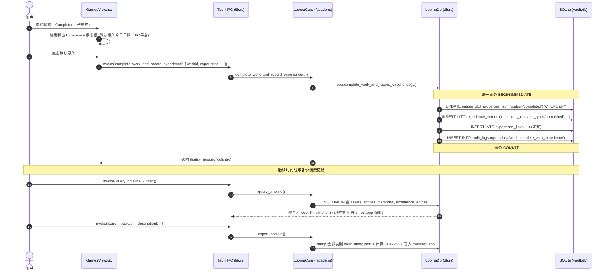
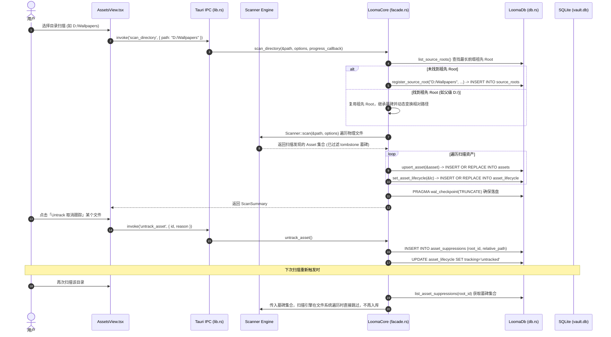
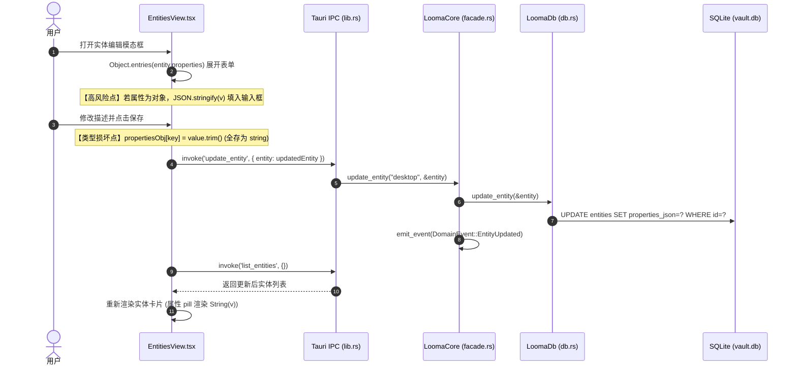

# Looma v0.5 真实可用性、数据语义与产品架构代码核实与讨论反馈报告

> **文档性质：** 本地 Antigravity（反重力）针对 `docs/Looma_v0.5_Product_Usability_Architecture_RFC_Discussion.md` 的代码级全量核实、调用链追踪、技术反方评审与产品方案反馈。  
> **遵守原则：** 严格遵守“先讨论，不写代码”指令。未修改任何 Rust/TypeScript/SQL 业务代码，未新增 Migration，未变更用户数据。所有结论均基于本地源码实测与静态调用链。  
> **审核对象：** 用户及后续 GPT 评审。

---

## A. 代码基线与环境

```text
Git commit SHA:             0cb44b418ce11902e130f6caf5319f10ead4bd38 (pushed to origin/master)
Git Branch:                 master
Working tree dirty:         No (clean)
Desktop EXE build time:     2026-11-15 08:41:41 (UTC+8)
Desktop EXE path:           D:\CodePackage\Persoanl\LoomaProject\Looma.exe
Desktop EXE size:           14,587,392 bytes (内嵌 Vite 生产 dist/ 静态资源，无外部 devServer 依赖)
Desktop FileVersion:        0.1.0 (来自 tauri.conf.json)
Core API / Model version:   0.1.0 (Cargo workspace)
Vault Schema version:       4 (001_initial, 002_audit_and_references, 003_experience, 004_source_root)
Database Engine:            SQLite (rusqlite 0.31, WAL 模式, busy_timeout 5000ms)
Execution Platform:         Windows 11 (x86_64)
Test Verification:          cargo test --workspace (106 tests passed, 0 failed, 0 ignored)
Vault Data Safety:          未执行任何破坏性操作，未触碰真实用户 Vault 路径
```

---

## B. 当前真实数据流图

### 1. 游戏候选扫描与建档数据流 (Game Candidate → Work/Entity → Local Path)

```mermaid
sequenceDiagram
    autonumber
    actor User as 用户
    participant GV as GamesView.tsx
    participant IPC as Tauri IPC (src-tauri/src/lib.rs)
    participant Core as LoomaCore (facade.rs)
    participant DB as LoomaDb (db.rs)
    participant SQLite as SQLite (vault.db)

    User->>GV: 点击「扫描游戏目录」(默认 D:/Games)
    GV->>IPC: invoke('scan_game_candidates', { path })
    IPC->>Core: scan_game_candidates(&path)
    Core->>Core: 遍历子目录，检测 .exe / 匹配现有 Work
    Core-->>GV: 返回 Vec<GameCandidate>
    User->>GV: 点击「建立游戏档案」(cand)
    GV->>IPC: invoke('create_work', { title: cand.deduced_title, kind: 'game', ... })
    IPC->>Core: create_work(actor, title, WorkType::Game, status, ...)
    Core->>Core: Entity::new_work() 生成 id="work_xxxxxxxx"
    Core->>DB: create_entity("desktop", &entity)
    DB->>SQLite: INSERT INTO entities (id, entity_type='game', properties_json={work:...})
    GV->>IPC: invoke('link_work_directory', { workId, path: cand.path })
    IPC->>Core: link_work_directory(actor, workId, dir_path)
    Core->>DB: ensure_directory_asset() -> INSERT INTO assets (kind='directory')
    Core->>DB: link_work_asset() -> INSERT INTO relations (relation_type='attaches')
    GV->>IPC: invoke('list_works', { workType: 'game' })
    IPC->>Core-->>GV: 返回更新后的游戏列表
```

*权威数据源：* 游戏实体保存在 `entities` 表（`entity_type='game'`，嵌套 `properties_json.work`）；物理路径并不在 `entities` 表，而是作为独立 `Asset(kind='directory')` 存入 `assets` 表，再由 `relations` 表建立 `(work_id, 'attaches', asset_id)` 关系关联。

---

### 2. 用户通关与足迹记录数据流 (Completed → Experience → Timeline → Backup)



*权威数据源：* `entities.properties_json` 维护当前业务状态（`status='completed'`），`experience_entries` 维护不可变的历史足迹（支持多次通关、多周目，每次插入新 UUID 记录）。

---

### 3. 根目录扫描与生命周期绑定数据流 (Scan Root → Asset → SourceRoot → Rescan)



*权威数据源：* 资产本体在 `assets`，路径归属与在线状态在 `asset_lifecycle`，取消跟踪的黑名单墓碑在 `asset_suppressions`。扫描引擎与数据库通过 `root_id` + `relative_path` 解耦。

---

### 4. 实体与资产编辑更新数据流 (Edit → Tauri IPC → Core → DB → UI)



*权威数据源：* `entities.properties_json` 为唯一存储。但前端通用编辑器目前缺乏类型保护，全量字符串化覆盖造成后端嵌套解析失败。

---

## C. 代码核实矩阵（F-01 至 F-10 全量核实）

经过对本地最新提交 `0cb44b4` 的逐行静态审查与调用链验证，核实结果如下：

| 编号 | 结论 | 证据位置与调用链 | 实际代码表现与复现结果 | 严重度与风险分析 |
|:---:|:---:|:---|:---|:---:|
| **F-01** | **完全属实** | `crates/core/src/models/work.rs:356-361`<br>`crates/core/src/facade.rs:1360-1412`<br>`WorksView.tsx:94`, `GamesView.tsx:111` | `Entity::new_work()` 生成 `entity_type: "game"`（或其他作品类型），并将核心模型存放在 `properties["work"] = WorkMetadata`。`WorksView` 与 `GamesView` 底层均调用 `list_works`，读取的是同一个 `entities` 表记录。 | **P1 (架构混淆)**<br>数据层统一，但 UI 层分为 WorksView 与 GamesView 两个独立维护入口，造成认知割裂。 |
| **F-02** | **完全属实**<br>*(已代码确认)* | `apps/desktop/src/components/EntitiesView.tsx`<br>读取：`L138-142`<br>保存：`L170-176`<br>展示：`L454` | **读取时：** `typeof v === 'object' ? JSON.stringify(v) : String(v)` 将对象转为 JSON 字符串。<br>**保存时：** `propertiesObj[trimmedKey] = value.trim()` **无条件以字符串形式保存**！<br>**后果：** 在通用实体编辑器保存游戏实体后，`properties.work` 从 JSON Object 退化为 JSON String 标量。Rust 端 `as_work_metadata()` 的 `serde_json::from_value::<WorkMetadata>` 直接报错，导致进度、别名、封面、原名全部丢失！<br>**展示时：** 详情卡片使用 `{String(v)}`，未编辑的对象直接显示为 `[object Object]`。 | **P0 (高危数据损坏)**<br>用户在实体概念页面随手修改作品描述，会导致该作品的结构化 Work 元数据永久损坏。 |
| **F-03** | **完全属实**<br>*(已代码确认)* | `apps/desktop/src/App.tsx:67`<br>`apps/desktop/src-tauri/src/lib.rs:31-35`<br>`crates/database/src/db.rs:480-485` | **参数失配：** 前端传递 `{ limit: 50, offset: 0 }`，但 Tauri 命令参数签名为 `filter: Option<AssetFilter>`。Tauri 反序列化找不到顶层 `"filter"` 键，因此将 `filter` 反序列化为 `None`。<br>**无界查询：** 后端调用 `filter.unwrap_or_default()`，其 `limit` 字段为 `None`。`db.rs:480` 仅在 `filter.limit.is_some()` 时添加 SQL `LIMIT`。<br>**实际结果：** 实际执行的是无 `LIMIT` 的全表扫描！1 万或 10 万资产在启动时被一次性全量加载并常驻 React 内存。 | **P0 (高危性能隐患)**<br>大规模资产下，每次刷新或启动会导致 IPC 序列化暴涨、内存飙升并卡死 UI。 |
| **F-04** | **完全属实** | `apps/desktop/src/components/AssetsView.tsx:435`<br>`apps/desktop/src/components/AssetsView.tsx:94`<br>`apps/desktop/src-tauri/src/lib.rs:105-128` | **卡片无图：** 资产网格卡片仅渲染 `getKindIcon(asset.kind)`，全库不存在任何 ThumbnailService 或缩略图持久化缓存。<br>**全量 Base64：** 仅在点击详情后调用 `read_asset_preview`，将最大 30MB 的原图一次性读入内存并转为 Base64 data URL。 | **P1 (核心体验缺失)**<br>找图只能看文件名；若在列表中渲染原图会直接导致 OOM。 |
| **F-05** | **完全属实** | `apps/desktop/src/components/GamesView.tsx:155-162`<br>`apps/desktop/src/components/GamesView.tsx:178-181`<br>`apps/desktop/src/components/GamesView.tsx:199-202` | **章节固定：** `handleQuickStepProgress` 中 `positionType: 'chapter'` 为硬编码，按 +/- 步进强制将进度改为“章”。<br>**强制今日：** 标记通关或打开足迹模态框时，代码通过 `new Date().toISOString().substring(0, 10)` 强行预填今天日期、精度固定为 `day`、平台固定为 `PC`。 | **P1 (数据语义污染)**<br>单机/模拟器游戏被迫显示为“0 章”；历史补录极易误将通关日期记录为今天。 |
| **F-06** | **完全属实** | `crates/database/src/db.rs:1687-1785`<br>`crates/core/src/models/timeline.rs:8`<br>`apps/desktop/src/components/TimelineView.tsx:70-113` | **时间语义混排：** `TimelineItem.timestamp` 为严格的 `DateTime<Utc>`。`db.rs:1781` 对未知精度的历史足迹强行回退为 `created_at`（登记日期）。<br>**资产淹没足迹：** 扫描进来的数千个文件的修改时间与用户宝贵的人生足迹混在一起排序。<br>**前端 Fallback 缺陷：** `TimelineView.tsx` 离线回退代码中仅合并 assets、entities、memories，**完全漏掉了 experiences**。 | **P1 (核心价值稀释)**<br>时间线被文件修改时间完全霸占，用户无法清晰回顾“某一年我通关了什么”。 |
| **F-07** | **完全属实** | `apps/desktop/src/components/InsightsView.tsx:70-90`<br>`crates/intelligence/src/engine.rs:378` | **虚假成功反馈：** `handleBatchApplyHigh` 循环调用 `safeInvoke('apply_smart_suggestion')`，不检查每次调用的布尔返回值，循环结束后直接无条件弹出 `autoApplySuccess` 提示成功。<br>**静默丢错：** 后端 `engine.rs:378` 往合集添加条目时使用 `let _ = core.add_item_to_collection(...)` 静默吞掉错误。 | **P0/P1 (诚信与一致性)**<br>部分应用失败或全失败时用户误以为已整理完毕，造成不可逆的错误分类。 |
| **F-08** | **完全属实** | `App.tsx:37-44`<br>等 10 个组件中的 `safeInvoke` 实现 | 10 个前端视图组件各自复制了一套 `safeInvoke`，全部在 `catch (err)` 中仅打印 `console.warn` 并返回 `null`。<br>**后果：** 后端数据库锁（`SQLITE_BUSY`）、约束冲突或系统错误被彻底掩盖，前端表现为“空列表/暂无数据”，严重误导用户以为数据丢失。 | **P0/P1 (错误可见性)**<br>无法区分“真的没有数据”还是“数据库发生错误无法读取”。 |
| **F-09** | **完全属实** | `crates/database/src/db.rs:69`<br>`crates/database/src/db.rs:127`<br>`apps/desktop/src/App.tsx:56`<br>`apps/desktop/src/webAdapter.ts:34` | **硬编码源头：** 新建数据库初始化时，`db.rs:69` 执行 `INSERT OR IGNORE INTO vault_meta (key, value) VALUES ('version', '0.2.0')`。<br>**连锁反应：** 后端 `get_vault_info` 查表返回 `"0.2.0"`；前端 IPC 失败回退也写死 `"0.2.0"`。无论前端还是后端，展示的都是硬编码的历史版本字符串。 | **P2 (版本定位困难)**<br>无法通过 UI 准确获知当前运行的 Core 版本、桌面打包 SHA 或 Schema 版本。 |
| **F-10** | **完全属实** | `crates/database/src/db.rs:17-27`<br>`crates/database/src/db.rs:50, 93` | **进程边界明确：** `LoomaDb` 使用 `Arc<Mutex<Connection>>`，注释明确说明仅保证“单进程内多线程同步”。<br>**多进程现状：** Desktop、CLI、MCP 为独立 OS 进程，均直接打开同一 `vault.db` 文件。虽然启用了 WAL 模式和 5000ms `busy_timeout`，但多进程并发写仍可能偶发超时；更关键的是**缺乏跨进程缓存失效与变更通知机制**。 | **P1 (多端协同边界)**<br>MCP 写入后桌面端无法感知，需手动刷新或重启。 |

---

## D. 12 组问题逐项讨论（Q1 至 Q12）

### Q1. Work、Game、Entity 究竟是什么关系？（领域身份 / 单一真相源）

- **目前真正做了什么：**
  - 在底层数据库中，不存在独立的 `works` 表，只有 `entities` 表。
  - Work 是一种特殊的 Entity：`entity_type` 为 `"game"`、`"anime"`、`"movie"` 等，并在 `properties_json` 中嵌套了包含 `WorkMetadata`（包含 `work_type`, `status`, `progress`, `aliases` 等）的对象。
  - 在桌面端，`WorksView.tsx` 与 `GamesView.tsx` 调用同一个 IPC 命令 `list_works`，但 `GamesView` 固定传入 `workType: 'game'`。
  - 游戏关联的物理文件夹不是 `entities` 表的字段，而是作为 `Asset(kind='directory')` 存入 `assets` 表，并通过 `relations` 表的 `relation_type = 'attaches'` 关联到 Work 实体。
- **缺失的能力与关键限制：**
  - **身份重复：** 用户在 `WorksView` 手动新建了《艾尔登法环》，随后在 `GamesView` 扫描候选目录并点击“建立游戏档案”，系统会基于目录名创建第二个独立的 Work 实体，造成同一游戏在库中存在两个副本。
  - **入口割裂：** 候选目录扫描、多安装目录绑定（附加位置）、足迹录入目前**只做在了 GamesView**；用户在 `WorksView` 查看同一款游戏时，看不到候选扫描，也无法记录足迹。
- **方案 A（推荐，最小改动）：**
  - **保持数据模型不变**（继续沿用 `entities` + 嵌套 `work` 元数据）。
  - **共享详情抽屉（Work Detail Drawer）：** 无论从“作品档案”还是“游戏库”点击卡片，弹出的主详情面板统一复用同一个具有完整能力的详情组件（支持看状态、看足迹、改别名、看关联文件）。
  - **创建去重提示：** 在根据候选目录创建游戏时，先按目录清洗名匹配现有 Work 的 `title` 和 `aliases`；若已有对应作品，优先引导“关联为该作品的安装目录”，避免生成同名冗余实体。
- **方案 B（重构方案）：**
  - 在 SQLite 中拆分出独立的 `works` 表与 `work_locations` 表，剥离通用的 `entities` EAV 模式。
- **反方意见（为何不选 B）：**
  - 拆表将破坏历史数据库兼容性，导致 `001~004` 迁移必须重写或做复杂数据搬迁，严重违背 Local-first 的平滑升级承诺。
- **推荐结论与置信度：**
  - **推荐方案 A。** 置信度高（95%）。核心是“单一真相源、统一详情页”，消除同一对象在两个页面的能力不对称。

---

### Q2. 是否存在编辑器导致的结构化属性损坏？（高危数据损坏）

- **目前真正做了什么：**
  - `EntitiesView.tsx:138-142`：编辑打开时，`Object.entries(entity.properties)` 将对象类型字段通过 `JSON.stringify(v)` 展平为文本框中的字符串。
  - `EntitiesView.tsx:170-176`：保存时，直接将文本框中的输入作为普通字符串存回 `propertiesObj[trimmedKey] = value.trim()`。
- **缺失的能力与关键限制：**
  - 缺乏类型逆向解析（Type Hydration）机制，且通用编辑器允许无限制修改属于 Work 领域私有的保留键（如 `work`, `domain`, `status`）。
  - 一旦保存，SQLite 中 `properties_json` 内的 `"work"` 字段由 JSON Object 变为 JSON String 标量，彻底破坏 Rust 端强类型反序列化。
- **方案 A（推荐，最小改动，防破坏）：**
  - **保护系统保留字段：** 通用实体编辑器中，对 `domain === 'work'` 的实体，禁止在动态属性行中直接编辑 `work` 对象，将其标记为只读展示或隐藏；
  - **增加 JSON 安全解析回退：** 保存时，若字符串以 `{` 或 `[` 开头，尝试 `JSON.parse()`；若解析成功则存回 Object/Array，否则存为 String；
  - **详情展示修复：** `EntitiesView.tsx:454` 将 `{String(v)}` 改为：若是对象则展示格式化标签或缩略摘要，杜绝 `[object Object]`。
- **方案 B（深度方案）：**
  - 在后端 `update_entity` 中增加 Schema Guard，拒绝非法的 `work` 属性覆盖。
- **反方意见：**
  - 纯后端拦截若前端没有对应表单支持，会导致保存直接报错；因此前后端协同校验更稳妥。
- **推荐结论与置信度：**
  - **推荐方案 A + B 双重防御。** 置信度极高（99%）。这是当前排查出的最明确的数据破坏缺陷，必须优先消除。

---

### Q3. 大规模资产的加载、分页、搜索是不是同一套真实路径？

- **目前真正做了什么：**
  - 前端 `App.tsx:67` 传递 `{ limit: 50, offset: 0 }`，但由于缺少 `filter: {...}` 外层包装，Tauri 后端反序列化为 `None`，导致执行了无 `LIMIT` 的全表查询，将所有资产全量拉取到 React 内存。
  - `GlobalSearchModal.tsx:91-100` **完全没有调用后端搜索**，而是直接遍历由 `App.tsx` 传入的全局 React props 数组做纯内存子串匹配。
- **缺失的能力与关键限制：**
  - 在 1 万~10 万文件规模下，启动时 IPC 传输和 JSON 解析开销巨大（预计数百 MB 内存），首屏严重卡顿。
  - 全局搜索受限于前端已加载的数据；如果前端修复了分页限制为 50 条，全局搜索将只能搜索这 50 条，彻底失效！
- **方案 A（推荐，最小闭环）：**
  - **修复 IPC 契约：** 前端调用改为 `invoke('list_assets', { filter: { limit: 100, offset: 0 } })`；
  - **全局搜索切到后端：** `GlobalSearchModal` 调用后端专有的 `search_vault` IPC 命令（走 SQLite 索引或 FTS），不再依赖前端内存数组全量遍历；
  - **资产列表引入轻量分页/无限滚动：** 页面按页拉取，不再一次性塞满状态。
- **方案 B（重型方案）：**
  - 引入虚拟滚动列表（react-virtualized）及前端 IndexedDB 客户端二级缓存。
- **反方意见（为何不立即做 B）：**
  - 在未接入缩略图且没有真正数万资产的日常场景下，引入虚拟列表和客户端缓存会显著增加 UI 复杂度和状态同步 Bug。
- **推荐结论与置信度：**
  - **推荐方案 A。** 置信度高（95%）。解决前后端契约断裂是第一要务。

---

### Q4. Reference 图片预览怎样才真正好用？

- **目前真正做了什么：**
  - `AssetsView.tsx:435` 卡片仅展示静态图标 `getKindIcon(asset.kind)`。
  - 只有在点击弹出的详情抽屉中，才调用 `read_asset_preview` 读取原文件（限制 30MB）并做 Base64 编码内嵌。全系统无缩略图服务。
- **缺失的能力与关键限制：**
  - 用户在资产库浏览壁纸、照片、封面时，必须“盲猜文件名”，可用性极差。
  - 若在卡片网格中直接调用现有 `read_asset_preview`，同时加载数十张数 MB 的大图，会导致前端内存爆炸。
- **方案 A（轻量图片缩略图，推荐）：**
  - **只针对图片（Image）类型：** 暂不扩大到视频帧抽样或 3D 渲染。
  - **按需生成本地轻量缓存：** 当资产列表可见时，后端通过 Rust `image` crate 生成最大边长 320px 的轻量 WebP/JPEG 缩略图，存放在 Vault 的 `.looma/cache/thumbnails/<asset_hash>.webp`。
  - **自定义协议/本地协议读取：** 通过 Tauri 的 `asset:` 协议或专门的轻量 IPC 读取缓存字节，杜绝原图全量 Base64 传输。
  - **不可变与可丢弃原则：** 缓存目录可随时被一键清空，原文件移动或离线时不破坏原有资产记录。
- **方案 B（扩展全媒体预览平台）：**
  - 集成 ffmpeg 做视频抽帧、pdfium 做 PDF 首屏渲染。
- **反方意见（为何坚决不做 B）：**
  - 引入 ffmpeg 外部二进制或复杂 C 绑定期望成本极高，极易引发 Windows 动态链接库分发和打包体积失控。
- **推荐结论与置信度：**
  - **推荐方案 A（仅做图片缩略图缓存）。** 置信度高（90%）。大幅降低找图成本，且完全恪守“不移动用户原文件”的原则。

---

### Q5. 个人足迹、状态进度和 Memory 之间怎样划界？

- **目前真正做了什么：**
  - `Work.status`（在 `entities.properties.work.status`）：表示作品当前的生命周期状态（`planned`, `in_progress`, `completed`, `dropped` 等）。
  - `ExperienceEntry`（在独立表 `experience_entries`）：表示一次具有个人意义的不可变历史足迹（如“通关”、“二周目通关”、“入坑”）。
  - `Memory`（在 `memories` 表）：通用的主观文本随笔/笔记。
  - 目前在 `GamesView.tsx` 中，用户将状态改为 `completed` 时，可以点击“只改状态不记足迹”，此时 `Work.status = 'completed'` 但无 `ExperienceEntry`。
- **缺失的能力与关键限制：**
  - **模态框预填陷阱：** `GamesView.tsx:178` 强行预填今天日期、`day` 精度、`PC` 平台。历史补录时用户容易直接点保存，导致足迹时间与真实历史脱节。
  - **范围不对称：** 该能力仅在 `GamesView` 提供，`WorksView` 完全无法记录足迹。
- **方案 A（推荐，自然交互划界）：**
  - **状态与足迹解耦但联动：** `Work.status` 是当前概况，`Experience` 是历史序列。允许多次 `completed` 足迹（二周目、全成就），不覆盖旧足迹。
  - **补录友好型 UI：** 足迹录入界面的日期选择器明确提供：“准确日期”、“大概年月”、“仅记得年份”、“时间记不清了（未知）”4 档选项，**默认不勾选任何虚假今天日期**；
  - **推广至全作品详情：** 将足迹录入能力迁移到统一的 `WorkDetailDrawer`，追番、读完一本书、通关游戏均可一键记录足迹。
- **方案 B：**
  - 强行绑定：只要状态变为 Completed，强制必须生成一条 Experience。
- **反方意见（为何反对 B）：**
  - 有些作品用户可能只是整理旧列表，强迫填写足迹细节会极大增加记录心理负担。
- **推荐结论与置信度：**
  - **推荐方案 A。** 置信度高（92%）。达成“两次点击以内完成足迹补录，且绝不伪造虚假日期”。

---

### Q6. 时间线的“事实时刻”怎样定义？

- **目前真正做了什么：**
  - `TimelineItem.timestamp` 只有单一的 `DateTime<Utc>`。
  - 在 `db.rs:1781` 中，如果足迹的 `occurred_precision == 'unknown'`，代码强制回退到 `created_at`（登记日期）。
  - 所有资产的文件系统修改时间（`asset.modified_at`）与足迹、手记混合，在同一个列表中按时间绝对倒序排列。
- **缺失的能力与关键限制：**
  - 一旦用户扫描导入了 1000 张壁纸或一个游戏目录，时间线立即被上千条资产文件时间刷屏，具有纪念意义的人生足迹被彻底湮没。
  - 5 年前通关的游戏今天补录，因为时间未知被赋上了“今天”的时间戳，导致回顾历史时逻辑颠倒。
- **方案 A（推荐，双轨视图 / 语义分离）：**
  - **主视图默认聚焦「回忆与经历（Footprints & Life）」：** 默认仅展示 `experience_entries` 和 `memories`；
  - **切页提供「系统活动与资产入库（System & Files）」：** 供用户追溯何时扫描了哪些文件；
  - **未知时间单列呈现：** 对 `occurred_precision == 'unknown'` 的足迹，不在年份轴中伪装成今天，而是归入侧边栏“岁月长河 / 记忆珍藏（时间未详）”折叠组；对仅有年份（如“2020”）的，挂在该年份顶部概览，不伪造具体月日。
- **方案 B：**
  - 维持单时间线，仅在卡片上增加复杂的高级过滤下拉框。
- **反方意见（为何不选 B）：**
  - 单时间线在混合数万条文件时，数据库必须对全表做全局排序，查询性能极差，且无论怎么筛选依然容易误读。
- **推荐结论与置信度：**
  - **推荐方案 A。** 置信度高（95%）。让时间线真正回归“个人回忆录”，而非“操作系统事件查看器”。

---

### Q7. 来源根目录、扫描候选、作品名和重连如何形成用户可理解的流程？

- **目前真正做了什么：**
  - 游戏候选识别根据文件夹名清洗生成 `deduced_title`。
  - 用户确认候选后，直接将清洗后的名字创建为 Work 实体（`create_work`），并在描述中写死 `扫描自本地位置: ${cand.path}`。
- **缺失的能力与关键限制：**
  - 自动清洗可能粗暴抹去“汉化版”、“Remake”、“Demo”等重要版本信息，或者将长目录名误识别。
  - 缺少“原始目录名”、“作品规范名（Title）”、“显示别名（Alias）”的分离呈现。
- **方案 A（推荐，可回滚的候选确认流程）：**
  - **候选确认时不静默重写：** 弹出的建档卡片中，同时展示【识别出的建议名】（如 `Final Fantasy VII Remake`）与【原始文件夹名】（如 `3DMGAME Final Fantasy VII Remake.CHS.Green`）；
  - 用户可一键接受建议名，或修改为自己喜欢的名字，原始文件夹名自动存入别名（`aliases`）或关联目录资产的备注中；
  - 来源根目录断开或盘符变更时，通过 Doctor 提示重绑定（`rebind_source_root`），保持 Work 身份与足迹不动。
- **方案 B：**
  - 引入网络抓取（如 IGDB、Bangumi API）强制自动匹配元数据。
- **反方意见（为何坚决不选 B）：**
  - 严重违背 Local-first 和无网络可用的底线，且容易因网络失败导致流程阻塞。
- **推荐结论与置信度：**
  - **推荐方案 A。** 置信度高（90%）。把决策权以极低成本留给用户，并保留原始来源痕迹。

---

### Q8. 首页、导航、信息架构是否应调整？

- **目前真正做了什么：**
  - `Sidebar.tsx:28-39` 铺开了 10 个平铺一级入口（概览、作品、游戏、资产、实体、集合、时光轴、手记、洞察、设置）。
  - 首页（`HomeView.tsx`）上半部分为宣传排版与 4 张统计卡片，缺乏直接的任务发起入口。
- **缺失的能力与关键限制：**
  - 入口严重过载。“实体概念”暴露给普通用户造成巨大理解负担（用户不知道自己为什么要维护“实体”）；“作品档案”和“游戏库”并列让人困惑。
- **方案比较：**
  - **A0（不动导航）：** 概念混乱依旧，新用户打开无所适从。
  - **A1（彻底合并游戏库至作品页）：** 游戏扫描与盘符管理的专属能力容易被稀释。
  - **A2（日常入口 + 高级管理折叠分区，推荐）：**
    - **核心日常区（一级展现）：** 概览（Home）、作品与足迹（Works & Games 统一或紧邻）、数字资产（Assets）、时光轴（Timeline）、记忆手记（Memories）；
    - **高级管理区（折叠/收起）：** 集合收藏（Collections）、实体图谱（Entities / 仅高级用户调试关系）、智能洞察（Insights）、系统设置（Settings）。
  - **A3（重构为任务导向 OS 首页）：** 改造面过大，极易引发全新 UI 缺陷。
- **推荐结论与置信度：**
  - **推荐方案 A2。** 置信度高（92%）。不删减功能，通过分组折叠立竿见影降低 60% 视觉认知噪音。

---

### Q9. 智能建议能不能“可信且可撤销”？

- **目前真正做了什么：**
  - `crates/intelligence/src/engine.rs:86-100`：85% / 98% 的置信度**完全是硬编码的分值规则**（如文件名完全匹配给 0.98，包含匹配给 0.90，父目录匹配给 0.88）。
  - `apply_suggestion`：
    - Relation 建议：直接写入 `relations` 表；
    - Cluster 建议：新建 Collection，并遍历将资产加入集合（加入失败被 `let _` 忽略）；
    - Tag 建议：代码中直接为 `// Future` 空实现，仅返回 `Ok(true)`。
  - `InsightsView.tsx:80` 批量应用即使失败也显示成功；无撤销记录，无预览。
- **缺失的能力与关键限制：**
  - 缺乏事务保护与批量结果统计；无操作审计可逆回滚。
- **方案 A（审慎可信方案，推荐）：**
  - **批量应用显示真实统计：** 统计 `成功 N 项 / 失败 M 项`，杜绝全成功假象；
  - **增加预览确认卡片：** 明确告知“将创建 1 个合集并关联 5 个资产”，用户可逐项取消勾选；
  - **弱化伪精确百分比：** 将 `98%`、`88%` 改为自然语言描述（如“强匹配：文件名完全一致”、“推荐：同名文件夹归类”）。
- **方案 B：**
  - 引入事务回滚栈与通用 Undo/Redo 架构。
- **反方意见（为何不立即做 B）：**
  - Undo/Redo 会大幅增加数据库复杂性。现阶段智能建议并非核心高频流程，先做到“解释清楚 + 诚实反馈 + 用户单项确认”即可。
- **推荐结论与置信度：**
  - **推荐方案 A。** 置信度高（90%）。避免误导比做复杂撤销系统更实用。

---

### Q10. 错误反馈、演示模式与版本识别有没有误导？

- **目前真正做了什么：**
  - `safeInvoke` 在 10 个组件内将所有 IPC 异常拦截为 `console.warn` 并返回 `null`。
  - `webAdapter.ts` 内置了纯浏览器演练模式；当在原生 Tauri 环境执行但后端调用失败时，虽然不会切入 Web 演练模式，但会触发各种局部静态 Fallback（如 `App.tsx` 写死 `version: '0.2.0'`，`TimelineView` 降级为前端拼装数组）。
  - 数据库初始化代码 `db.rs:69` 强行写入 `'0.2.0'`，导致界面永远显示 `0.2.0`。
- **缺失的能力与关键限制：**
  - 数据库锁定（Busy）、文件不可读、权限被拒时，用户看到的是静默空白或虚假的空状态，造成恐慌。
  - 无法准确排查桌面版本与 Git 提交。
- **方案 A（推荐，最小且根本的修复）：**
  - **建立统一的 API 调用层（`apiClient.ts`）：** 废弃 10 个组件中的分散 `safeInvoke`，统一区分返回：`{ success: true, data }` 或 `{ success: false, error: LoomaError }`；
  - **页面显式错误状态（Error State）：** 当数据库读取失败时，显示带重试按钮的警告卡片（如“读取作品库失败：数据库忙，请点击重试”），绝不允许伪装成“暂无作品”；
  - **真实版本链绑定：** 数据库 `vault_meta` 废除硬编码；IPC 命令提供 `get_app_version`，直接返回包含 Tauri 版本、Cargo 编译 SHA、Schema 版本的综合结构并在设置页呈现。
- **推荐结论与置信度：**
  - **推荐方案 A。** 置信度极高（98%）。这是建立长期软件信任的基础设施。

---

### Q11. 备份和删除类操作如何真正建立信任？

- **目前真正做了什么：**
  - 在已落地的提交 `0cb44b4` 中，备份恢复（`restore_backup`）已重构为**基于单个 SQLite Transaction 的强原子写入**，并对 `manifest.json` 与 `vault_dump.json` 的 SHA-256 校验和进行前置强制验证。
  - 备份导出（`export_backup`）打包了全部元数据、关系、外链、足迹和 Markdown 手记，但**绝不包含外部 Reference 媒体原文件**。
- **缺失的能力与关键限制：**
  - UI 设置页面（`SettingsView.tsx:211`）未明确向用户提示“备份仅包含数据索引与回忆，不包含大型媒体原件”，可能导致用户误以为备份包含数 GB 的视频/游戏本体。
  - 恢复是基于当前打开库的“原地 Upsert 合并”，而非创建新副本；若用户误操作恢复了旧备份，缺乏恢复前的自动快照。
- **方案 A（推荐）：**
  - **明确文案免责与边界说明：** 在导出和恢复卡片显著标明：“Looma 采用引用模式，备份包不包含外部游戏/媒体原文件”；
  - **恢复前自动安全快照：** 在执行 `restore_backup` 前，自动在 `.looma/backups/pre_restore_<timestamp>.db` 产生一份当前数据库快照，确保任何恢复均可原地无损回滚；
  - **Doctor 明确区分状态：** 检查报告中明确分离：“移动硬盘断开（受保护）”、“路径变更待重绑”与“文件确实损坏/删除”。
- **推荐结论与置信度：**
  - **推荐方案 A。** 置信度高（95%）。消除用户数据焦虑。

---

### Q12. 多进程、跨设备与外部 AI 的真实工作流是什么？

- **目前真正做了什么：**
  - 桌面版、CLI、MCP（`looma-mcp`）均为本地独立进程，通过 SQLite WAL + `busy_timeout(5000ms)` 实现文件级锁协调。
  - MCP 在 `0cb44b4` 中通过真实 OS 子进程 stdio 测试，默认严格以 `ReadOnly` 运行，仅在显式传入 `--allow-write` 时允许写入。
- **缺失的能力与关键限制：**
  - 当桌面 App 打开的同时，外部 AI 通过 stdio MCP 写入了一条 Experience，桌面 App 的 React 内存没有任何感知，页面不会自动更新。
  - 外部移动设备（DSH 小满等）无法直接跨网络连接本地 stdio MCP。
- **方案与边界明确（推荐）：**
  - **恪守架构边界：** **坚决不在 Looma 内部集成大模型或架设远程 HTTP 暴露服务**；跨设备交互应由外部专有网关（如用户已有的 DSH 同步或专用网盘通道）承担；
  - **本地轻量协同机制：** 在 SQLite 中利用 `PRAGMA data_version` 或轻量文件变更检测（File Watcher 监听 `vault.db`），当检测到外部进程修改时，桌面 App 静默触发局部 `onRefreshAll()` 刷新界面；
  - **MCP 任务流明确：**
    - 场景 1（通关记录）：MCP 接收“我通关了血源诅咒” -> 必须先调用 `find_works(query="血源诅咒")` -> 若只有 1 个强匹配，调用受控写入工具并附带理由；若有歧义，必须向用户追问确认。
    - 场景 2（找 RVC 模型及输出）：MCP 调用 `search_vault` 或 `query_relations` 寻找关联资产，只读输出文件路径给用户，不进行越权修改。
- **推荐结论与置信度：**
  - **推荐方案明确。** 置信度高（92%）。保持 Looma 作为“可信纯净的数据与资产沉淀底座”。

---

## E. 按真实使用任务给出价值排序（T-A ~ T-E 任务测算）

针对 RFC 第 7 节提出的 5 个核心场景，进行端到端操作步骤、瓶颈与最小改进测算：

| 场景代码 | 任务场景 | 现状操作步骤与阻塞点 | 最小改进后操作体验 | 改进成本 | 基础数据结构是否改变 |
|---|---|---|---|:---:|:---:|
| **T-A** | **《血源诅咒》通关补录**<br>*(无本地文件/日期不准/PC模拟器)* | **现状步骤（4~6步，存在误导）：**<br>1. 必须在 GamesView 点击新建游戏（WorksView 无法建关联路径）；<br>2. 填写作品名；<br>3. 在状态改为 Completed 时触发弹窗；<br>4. **致命点：** 弹窗默认填入今日日期，用户必须手动清空才能避免伪造历史。<br>5. 时间线中如果时间未知，被错误排入“今天”。 | **改进后体验（2步闭环）：**<br>1. 全局或作品详情点击「记录一次经历」；<br>2. 选定作品，类型选「通关达成」，时间选「年份/大概/记不清」，平台选「PC」，点击保存；<br>3. 自动更新状态为 Completed 并写入足迹，时间线归入对应年份或长河珍藏，不污染今日时间。 | **低**<br>(优化 UI 模态框逻辑与默认值) | **否**<br>(完全复用 v0.4 的 ExperienceEntry 模型) |
| **T-B** | **散乱壁纸目录找图**<br>*(1K/10K 图片/中文空格/离线盘)* | **现状步骤（严重受阻）：**<br>1. 扫描导入目录（耗时正常）；<br>2. 打开资产库：**全部为灰色默认文件图标**，无法直接肉眼找图；<br>3. 点击其中一张触发 30MB Base64 全量读取，耗时卡顿；<br>4. 若有 1 万张图，启动时因参数错误全表加载导致内存暴涨。 | **改进后体验（极度流畅）：**<br>1. 启动时修复分页，首屏毫秒级加载；<br>2. 资产网格展示 320px WebP 缩略图，秒看图片内容；<br>3. 支持拼音/中文实时子串过滤；<br>4. 硬盘拔出时资产标为“离线受保护”，插回后原样可用。 | **中**<br>(增加异步缩略图缓存生成器) | **否**<br>(缓存放在 `.looma/cache/`，不入库不改原件) |
| **T-C** | **开发项目 + RVC 文件检索**<br>*(项目/模型权重/音频/记录)* | **现状步骤（步骤繁琐）：**<br>1. 在实体页建 Project 实体；<br>2. 在资产页找模型文件和输出音频；<br>3. 逐个打开实体详情点“关联资产”；<br>4. 找回时无法从项目一键看全所有物料。 | **改进后体验：**<br>1. 统一的作品/项目主详情面板中，清晰划分「关联物料（Assets）」与「外部链接（GitHub等）」；<br>2. 一键拖拽或勾选关联，可在项目详情内一次性展开关联的所有音频与权重。 | **低~中**<br>(统一详情页物料聚合展示) | **否**<br>(复用现有的 Relations 模型) |
| **T-D** | **存量资料迁移与数据恢复**<br>*(含 SourceRoot/Untrack/Experience)* | **现状步骤：**<br>设置页点击导出备份，生成备份包；点击恢复备份，**基于当前库直接合并**。<br>后端事务已在 `0cb44b4` 修复为原子事务，但**前端缺乏恢复前自动快照**，用户不敢轻易点恢复。 | **改进后体验：**<br>1. 恢复前提示“将覆盖/合并现有数据，系统已自动创建安全快照”；<br>2. 校验 Manifest 与 Hash 进度条可见；<br>3. 恢复后自动刷新界面各视图，数据严丝合缝。 | **低**<br>(UI 增加快照触发与状态刷新) | **否**<br>(依赖已有原子事务引擎) |
| **T-E** | **智能建议部分失败**<br>*(批量注入故障)* | **现状步骤：**<br>点击批量应用，第 2 条失败，系统依然弹出“批量应用成功”；用户无法知道哪条成功哪条失败。 | **改进后体验：**<br>弹窗明确展示应用进度，列出“成功 2 项，失败 1 项（原因：目标实体不存在）”，并保留失败项供用户重试。 | **低**<br>(前端批量循环错误收集) | **否**<br>(无需修改核心模型) |

**价值排序结论：**  
`T-B (找壁纸与列表流畅度)` > `T-A (通关足迹补录两步闭环)` > `T-E (错误诚实反馈)` > `T-D (恢复安全快照)` > `T-C (项目物料归拢)`

---

## F. 未来路线图候选（最小价值演进包）

严格遵循“不增添过度设计、优先保障数据信任”原则，规划 4 个解耦的渐进包：

### Package 0 — 数据语义防线与错误可见性（必须最优先执行 / Bugfix & Safety）
- **为什么做：** 消除当前导致数据损坏（F-02 实体编辑器覆盖 Work）、全表无界加载（F-03）和静默失败欺骗（F-07, F-08）的 P0 级风险。
- **改动范围：**
  - `EntitiesView.tsx`：增加属性类型守卫，保留字段只读，修复 JSON 逆向解析，修复 `[object Object]` 显示。
  - `App.tsx` & `src-tauri/src/lib.rs`：修复 `list_assets` 的 `{ filter: {...} }` 参数契约。
  - 全局前端：废弃 10 处吞错的 `safeInvoke`，接入带有错误状态呈现的统一 API 响应机制。
  - `db.rs`：废除 `'0.2.0'` 硬编码，透传真实 Core 与 Schema 版本。
- **验收标准：**
  - 在实体概念页修改游戏实体描述，`get_work_summary` 读取出来的 `progress`、`cover_asset_id` 完好无损。
  - SQLite 产生错误时，UI 明确弹出告警卡片，绝不出现“假空数据”。

### Package 1 — 作品、游戏与足迹的自然闭环（核心体验交付）
- **为什么做：** 解决用户最核心的“通关补录、追番、多周目”需求，打通 WorksView 与 GamesView 的割裂。
- **改动范围：**
  - 抽取统一的 `WorkDetailDrawer`，在作品档案和游戏库共用。
  - 重构足迹录入模态框：支持“模糊日期（年份/未详）”，取消强制今日与强制 PC 预填。
  - 候选目录建档流程优化：保留原始目录作为别名，支持一键关联到已有作品。
- **验收标准：**
  - 补录《血源诅咒》通关只需 2 次点击；记录后在作品详情与游戏库均可同步看到足迹。

### Package 2 — 数字资产可视化与本地缩略图（找回体验升级）
- **为什么做：** 解决用户面对数千张壁纸、图片“只能看文件名盲猜”的痛点。
- **改动范围：**
  - 在 `crates/core` 引入轻量图片缩略图生成器（本地 `.looma/cache/thumbnails/`，上限约束 + 一键清理）。
  - `AssetsView.tsx` 网格卡片渲染缩略图，支持真实分页与关键字即时过滤。
  - 全局搜索 `GlobalSearchModal` 接入后端搜索，不再扫描前端受限数组。
- **验收标准：**
  - 首次扫描 1000 张壁纸后，列表能立即滚动预览缩略图，内存保持在 150MB 以下。

### Package 3 — 时间线与信息架构重整（视觉与认知减负）
- **为什么做：** 解决现有 10 个平铺导航视觉疲劳，让时间线成为真正的人生回忆录。
- **改动范围：**
  - `Sidebar.tsx`：分为“日常核心”与“高级管理（折叠）”。
  - `TimelineView.tsx`：双轨制（默认展示人生足迹与手记回忆；系统文件活动单独成页）。对未知日期的回忆做专属长河归类。
- **验收标准：**
  - 时间线不被刚导入的 1000 个文件冲刷，一眼能看清 2024~2026 年玩过什么、完成过什么。

### Package 4 — 可选增强（暂缓观察）
- 包含智能建议批量确认微调、外部 MCP 写入的主动桌面刷新通知等。根据前 3 个包的用户真实使用反馈再行决定。

---

## G. 明确列出“暂不做”及原因

为避免项目被无休止的“架构蓝图”拖垮，本轮明确将以下内容划入**坚决不做（Out of Scope）**列表：

1. **坚决不内置任何大模型（LLM）或聊天助手界面：** Looma 是个人数字与经历底座，负责高确定性存储与检索。外部 AI 消费走 MCP，内部不堆砌无谓的对话 UI。
2. **坚决不引入网络强制元数据刮削（Scraper）：** 避免网络不可用或源站改版导致核心建档流程瘫痪。坚持 Local-first 和用户自主录入。
3. **坚决不做自动搬移/重命名用户原始文件的逻辑：** 坚守 Reference Mode，用户的磁盘目录是神圣不可侵犯的，Looma 绝不充当“强制文件整理器”。
4. **坚决不在前端做全量重写或引入庞大的 UI 框架：** 沿用现有 Tailwind + React 栈，只做组件复用与逻辑加固，杜绝因重构引入更多回归 Bug。
5. **坚决不做视频抽帧/3D/PDF 等复杂格式的多媒体预览服务：** 目前只做基础图片（Image）缩略图，避免引入重量级 C++ 依赖（ffmpeg 等）导致打包与跨平台崩溃。
6. **坚决不做云备份与多端同步服务：** 保持本地文件的纯粹性，数据备份以标准 Zip/Folder 导出包为准。

---

## H. 需要用户与 GPT 最终决策的 5 个开放问题

经过全面调查与反方论证，绝大部分技术细节（如参数失配、类型损坏、硬编码）已有明确的代码级修复定论。仅有以下 5 个真正影响产品方向的抉择，需要用户与 GPT 共同审定：

1. **作品页与游戏库的界面定位关系：**  
   - *选项 1.1（推荐）：* 保留两个菜单，但**共享同一个核心详情抽屉**；游戏库作为专注游戏的“启动与周目工作区”，作品档案作为全品类（动漫/影视/书籍/游戏）的“全景概览”。  
   - *选项 1.2：* 将“游戏库”完全降级为作品档案里的一个快速过滤 Tab（类似过滤条件 `type=game`），侧边栏减少一个一级入口。

2. **时间线（Timeline）的默认呈现逻辑：**  
   - *选项 2.1（推荐）：* **双轨分离**。默认进入「回忆与足迹」轨道（只展示游戏通关、追番达成、手记）；右上角可切换到「文件与系统活动」轨道（展示扫描入库时间）。  
   - *选项 2.2：* 保持单一时间线，但在顶部提供醒目的多选过滤器（默认全选或记忆用户选择）。

3. **数字资产缩略图的存储位置与生命周期：**  
   - *选项 3.1（推荐）：* 存放在 Vault 隐藏目录 `.looma/cache/thumbnails/`，大小限制 500MB，支持随时在设置页一键清空并可随时重建。  
   - *选项 3.2：* 完全不落地到磁盘，纯内存按需生成并做 LRU 内存缓存（缺点：每次冷启动滚动都需要轻微 CPU 计算）。

4. **历史通关补录的“时间未详”如何归属：**  
   - *选项 4.1（推荐）：* 在时光轴底部设立专属区块“岁月长河 / 记忆珍藏（时间未详）”，不编造任何具体年份；  
   - *选项 4.2：* 允许用户指定“大概在高中时期”或“约 2018~2020 年”，挂在对应估算年份的末尾并打上“模糊时间”角标。

5. **后续实施节奏策略：**  
   - *策略 A（安全第一，强烈推荐）：* 先做一个纯粹的 **Package 0（安全与缺陷修复 PR）**，把 F-02 数据损坏、F-03 无界加载、F-08 吞错等低层硬伤一次性修干净并验收；之后再做 Package 1 的 UI 体验升级。  
   - *策略 B（打包推进）：* 将 Package 0 与 Package 1 合并为一个稍大的 v0.5 PR。

---

## 附：对 RFC 第 12 节 6 个决策问题的明确回答

1. **当前最妨碍真实使用的前三个问题：**
   - **① 资产库“盲猜文件名”且无界加载（F-04 + F-03）：** 图片没有缩略图，找图完全靠猜；且参数失配导致全表拉取，规模一大直接卡死。
   - **② 通用实体编辑导致 Work 元数据损坏（F-02）：** 随手一改就丢结构化字段，破坏用户对数据库安全性的信任。
   - **③ 通关足迹补录被强制填入今日日期（F-05 + Q5）：** 历史经历无法自然表达，时间线被系统文件修改时间彻底淹没。
2. **是否存在导入真实长期数据前必须修的风险？**
   - **存在且确凿。** 必须先修：① `EntitiesView` 保存时对象类型被字符串截断覆盖（F-02）；② `list_assets` 缺失 `filter` 包装导致的无界全量拉取（F-03）；③ 智能建议批量操作虚假成功反馈（F-07）。
3. **Work/Game/Entity 应该如何降低认知成本？**
   - **面向普通用户彻底折叠或隐藏“实体概念（Entities）”菜单**。实体是底层数据图谱的实现细节，用户无需理解；将作品档案与游戏库的详情页合二为一，统一呈现“当前状态 + 历史足迹 + 关联文件”。
4. **如何让“通关游戏”和“找壁纸”两件事极其简单？**
   - **通关游戏：** 提供一个 2 步模态框：支持选择“年份/模糊/未知”时间，点击即可同时更新状态与足迹，无需补图或写小作文。
   - **找壁纸：** 生成 320px WebP 缩略图卡片网格，配合输入框即时拼音/字符过滤，1 秒内定位到目标图片并可一键在资源管理器中定位。
5. **哪些能力在 v0.5 坚决不应该做？**
   - 内置 AI 聊天大模型、自动网页刮削、视频/音频重型解码预览、文件强制重命名整理、云同步。
6. **最值得做的 2~3 个可回滚小 PR：**
   - **PR 1 (Package 0)：** 修复实体保存类型擦除 + 修复资产分页参数契约 + 统一 API 错误可见性 + 消除 0.2.0 硬编码。
   - **PR 2 (Package 1)：** 统一 Work 详情抽屉 + 补录友好型足迹模态框 + 候选建档别名保留。
   - **PR 3 (Package 2)：** 图片本地轻量缩略图缓存生成器 + 资产网格可视化呈现。
