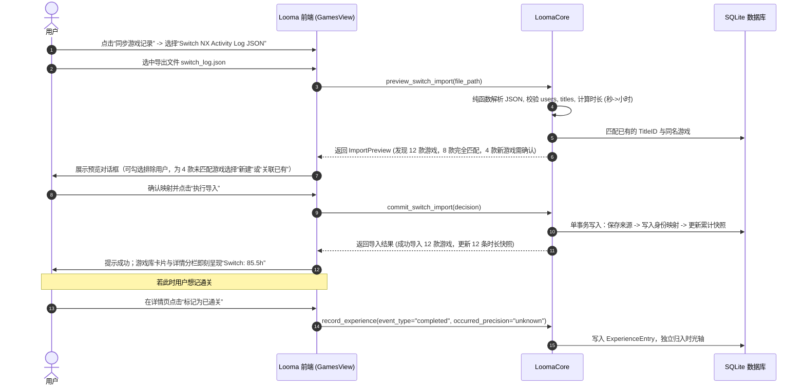

# Looma v0.6｜跨平台游玩事实、个人成就与 AI 识别：架构交叉讨论回复

> **文档版本**：Discussion Response v0.1 · 2026-11-15  
> **回复基线**：Git HEAD `75eb31a2529590d204fc2f64ba56f973f612eeed`（干净工作区，已推送到 origin/master）  
> **关联 RFC**：[Looma_v0.6_CrossPlatform_PlayHistory_AI_RFC_v0.1.md](file:///D:/CodePackage/Persoanl/LoomaProject/docs/Looma_v0.6_CrossPlatform_PlayHistory_AI_RFC_v0.1.md)  
> **性质**：代码级现场调查、技术方案反方辩论与决策建议，**不包含对业务数据库的破坏性变更或直接代码落地**。

---

## 1. 基线确认与当前运行状态

1. **实际 Git HEAD**：
   - 提交 SHA：`75eb31a2529590d204fc2f64ba56f973f612eeed`
   - 分支状态：`master`，与 `origin/master` 完全同步（5 个 PR 已全部推送）。
   - 工作区状态：`git status --porcelain` 为空，无未跟踪或未暂存修改。
2. **测试与质量状态**：
   - Rust Workspace：`cargo test --workspace` **112 项测试全部通过**（0 失败，0 告警）。
   - 前端静态检查：`pnpm --filter @looma/desktop exec tsc --noEmit` **0 错误**。
3. **独立二进制产物**：
   - 路径：[Looma.exe](file:///D:/CodePackage/Persoanl/LoomaProject/Looma.exe)（15.57 MB），为生产级 Tauri Release 构建，内置完整 Vite 前端静态产物，100% 离线脱离开发服务器运行。
4. **数据库迁移文件**：
   - `001_initial.sql` ~ `004_source_root.sql` 保持绝对只读，未被改动。

---

## 2. v0.5.1 尾项复核与隔离处理决议

反重力在 HEAD 代码中对 RFC 1.1 节指出的 4 个尾项进行了源码级核查，**确认 GPT 的判断全部属实且定位精准**：

| 尾项编号 | 源码定位 | 现状核验事实 | 隔离处理决议 |
| :--- | :--- | :--- | :--- |
| **尾项 1**<br>并发写覆盖与 CAS 缺失 | [crates/core/src/facade.rs](file:///D:/CodePackage/Persoanl/LoomaProject/crates/core/src/facade.rs#L345-L405)<br>`update_entity` | **属实**。代码在未传入 `work` 时会保留旧 WorkMetadata，并在传入非对象时报错；但当调用方传入合法但已过期的 `properties.work` 时，未校验 `updated_at` 或版本号，两进程并发提交会发生“后写胜出”丢失更新。 | 登记为独立补丁 `v0.5.1`，引入基于 `updated_at` 的乐观锁（CAS）并增加并发冲突测试；**不阻挡 v0.6 架构设计**。 |
| **尾项 2**<br>缩略图解码缺乏并发上限与像素阈值 | [crates/core/src/facade.rs](file:///D:/CodePackage/Persoanl/LoomaProject/crates/core/src/facade.rs#L2616-L2681)<br>`get_asset_thumbnail` | **属实**。代码通过 `.tmp` 写入重命名保证了原子落盘，但直接使用 `image::ImageReader::decode()` 全图解码。若用户导入 1 亿像素或几百兆的大图，并发 IPC 请求会引发瞬时 RAM 浪涌。 | `v0.5.1` 补充：① 解码前读取 header 尺寸，限制单图最大像素阈值（如 > 8000x8000 拒绝或分块降采样）；② Rust 端增加全局 `Semaphore`（如最多 4 个并发解码任务）。 |
| **尾项 3**<br>子组件 local safeInvoke 吞错 | [AssetsView.tsx](file:///D:/CodePackage/Persoanl/LoomaProject/apps/desktop/src/components/AssetsView.tsx#L117-L125) 等各 View 组件 | **属实**。`App.tsx` 顶层增加了 `setGlobalError` Toast，但各子组件内部私自重写了 `safeInvoke`（仅打印 `console.warn` 返回 `null`），导致子组件操作失败时用户看不到全局报错 Toast。 | `v0.5.1` 统一抽取全局 `invokeIpc` 模块，所有子组件复用统一错误分发管道。 |
| **尾项 4**<br>资产库前端分页断层 | [App.tsx](file:///D:/CodePackage/Persoanl/LoomaProject/apps/desktop/src/App.tsx#L78) & [AssetsView.tsx](file:///D:/CodePackage/Persoanl/LoomaProject/apps/desktop/src/components/AssetsView.tsx) | **属实**。`App.tsx` 首屏加载受控参数 `{ filter: { limit: 50, offset: 0 } }`，但 `AssetsView` 仅对内存中的这 50 条做 `filter`，缺少向上翻页/滚动加载下一批资产的 IPC 请求。 | `v0.5.1` 改造 `AssetsView` 为受控服务端分页（输入页码与过滤条件时向 Tauri 发起 `list_assets` 请求）。 |

> **决议**：坚决采纳 GPT 意见，上述 4 项严禁混入 v0.6 讨论，将作为 `v0.5.1` 极简加固包另行发布。

---

## 3. Q01–Q18 逐条源码级答复

### 领域与持久化 (Domain / Persistence)

#### Q01. `WorkMetadata` 字段能力与旧数据语义风险
- **文件与行号**：[crates/core/src/models/work.rs:286-308](file:///D:/CodePackage/Persoanl/LoomaProject/crates/core/src/models/work.rs#L286-L308)
- **当前现状**：`WorkMetadata` 仅有 `work_type`, `status`, `original_title`, `release_year`, `start_date`, `end_date`, `cover_asset_id`, `rating`, `progress: Option<WorkProgress>`, `type_metadata: Option<TypeSpecificMetadata>`, `aliases: Vec<String>`。其中 `GameSpecificMeta` 仅有 `platform: Option<Vec<String>>`, `developer`, `publisher`, `engine`。
- **是否存在字段**：**完全没有**累计时长、外部游戏 ID、分平台会话快照字段。
- **能否直接写入 `properties.work`**：单值的平台标签可以；但累计时长与多设备快照**坚决不能**塞入 `WorkMetadata`。`WorkMetadata` 代表跨平台的“作品作品级主观属性”，若将 Switch/PC/Steam 高频变化的活动数据硬塞进 JSON，会造成备份体积膨胀、并发写严重冲突，并破坏原有类型的序列化语义。

#### Q02. `ExternalReference` 是否适合存 `switch:title_id` / `steam:appid`？
- **文件与行号**：[crates/core/src/models/external_reference.rs:4-15](file:///D:/CodePackage/Persoanl/LoomaProject/crates/core/src/models/external_reference.rs#L4-L15)；表定义见 [002_audit_and_references.sql:18-29](file:///D:/CodePackage/Persoanl/LoomaProject/crates/database/src/migrations/002_audit_and_references.sql#L18-L29)。
- **当前行为**：强依赖 `url: String` 字段，用于存储可点击的 Web 链接（Bangumi、VNDB、GitHub、Steam 商店页等），表结构缺少 `user_scope`，且没有任何外部唯一性约束索引。
- **不适合原因**：
  1. `switch:title_id`（如 `01007ef00011e000`）不是 Web URL；
  2. 无法表达“设备/用户账号”维度（一台 Switch 可有多个用户 Profile）；
  3. 语义混淆：外链是“参考资料”，而外部游戏标识是“设备数据映射身份”。
- **方案**：建议创建专用的轻量映射结构 `ExternalGameIdentity`。

#### Q03. `ExperienceEntry` 能否无破坏容纳“Switch 通关”？防重逻辑是什么？
- **文件与行号**：[crates/core/src/models/experience.rs:19-38](file:///D:/CodePackage/Persoanl/LoomaProject/crates/core/src/models/experience.rs#L19-L38)；门面见 [facade.rs:2232](file:///D:/CodePackage/Persoanl/LoomaProject/crates/core/src/facade.rs#L2232)。
- **当前现状**：完全能够无破坏容纳！
  - `event_type`: `"completed"`
  - `occurred_precision`: `"unknown"` / `"year"` / `"month"` / `"day"`
  - `context_json`: 可存放 `{"platform": "Switch", "source": "nx_activity_log", "device": "Switch OLED", "playtime_hours": 85.5}`
- **防重复机制**：`LoomaCore::record_experience` 已经原生支持 `request_id: Option<(&str, &str)>` 幂等保护机制（在 `experience_test.rs::test_t03_idempotent_request_id` 已验证）。若基于 Switch 导入批次与 Title ID 生成确定的 `request_id`（如 `switch_import_<user_id>_<title_id>`），二次同步绝对不会产生重复通关记录！

#### Q04. 当前 Backup/Restore 涵盖哪些表？新增数据时需要同步修改什么？
- **文件与行号**：[crates/database/src/db.rs:1943-2060](file:///D:/CodePackage/Persoanl/LoomaProject/crates/database/src/db.rs#L1943-L2060) (`export_backup` 与 `restore_backup`)
- **当前显式快照表**：`assets`, `entities`, `memories`, `collections`, `external_references`, `experiences`, `experience_links`, `relations`, `source_roots`, `asset_suppressions`, `asset_lifecycles` 共 11 个表/集合。
- **新增数据契约**：如果新增外部活动与游戏身份表，必须**强制同步修改**：
  1. `export_backup`：导出对应集合至 `vault_dump.json`；
  2. `restore_backup`：在同一 SQLite 统一事务内恢复对应表；
  3. `generate_manifest` 与 `VaultManifest`：更新对象计数与哈希；
  4. 绝不能在没有同步 Backup 的情况下单方面在数据库里建表。

#### Q05. 现有 Core 是否支持单事务完成“更新映射 + 保存累计快照 + 审计 + 可选 Experience”？
- **文件与行号**：[crates/core/src/facade.rs](file:///D:/CodePackage/Persoanl/LoomaProject/crates/core/src/facade.rs)
- **当前限制**：`LoomaCore` 的底层 `LoomaDb` 使用互斥锁保护 SQLite 连接（`let conn = self.conn.lock()`），大部分现有门面方法是一次调用开启一个独立事务。
- **解决边界**：必须在 `LoomaDb` 仓储层提供原生的事务执行函数 `commit_activity_import_tx(&ImportDecision)`，在一个 `BEGIN TRANSACTION ... COMMIT` 内原子写入游戏映射与快照，外部通过 `LoomaCore` 调用并记录审计事件。

---

### Switch 导入 (Switch Import)

#### Q06. NX Activity Log JSON 规范核实与脱敏夹具
- **外部规范核验**：NX Activity Log 导出的 JSON 结构已确认：
  - 顶层：`exportTimestamp` (u64 秒), `exportVersion` (u32, 目前通常为 1), `users` (数组)。
  - 用户：`id` (128位 Hex，16字节), `name` (字符串), `titles` (数组)。
  - 作品：`id` (16位 Hex TitleID), `name` (UTF-8 游戏名), `summary`:
    - `firstPlayed` (u64 epoch，0 代表无), `lastPlayed` (u64 epoch), `launches` (u32), `playtime` (**严格以秒为单位**，非毫秒，非小时！)。
    - `events`: 数组，包含 `clockTimestamp`, `steadyTimestamp`, `type` (0=Applet启动, 1=退出等)。部分精简导出或旧版本中 `events` 为 `[]`。
- **解析边界策略**：
  1. `playtime` 必须经由 `playtime_seconds / 3600.0` 计算为浮点小时；
  2. `firstPlayed` / `lastPlayed` 为 0 时解析为 `None`，不伪造成 1970-01-01；
  3. 时钟突变（如 lastPlayed < firstPlayed）标记异常数据，仍保留原值；
  4. 脱敏测试夹具必须包含单用户、多用户、无 events 纯 summary、以及多语言（中/日/英）Title 名称。

#### Q07. Switch 用户标识私密性与本地 Profile 映射
- 一台 Switch 导出文件包含全部本机 Profile。
- **隐私保护**：预览阶段只展示 Profile 名称与已玩游戏数量；
- **用户自选**：允许用户勾选“仅导入 Profile [X]”，其他 Profile 数据不解析、不写库；
- 用户的 Switch 128位 ID 仅保存在 `ActivitySource` 的 `user_scope` 中，对外完全脱敏。

#### Q08. 导入场景状态机（二次导入、时长变小、同名不同 ID）
1. **相同文件导入两次**：计算文件哈希 `file_sha256`。若已存在相同批次，提示“该导出已于 [时间] 导入”，直接幂等跳过，增量为 0。
2. **相同游戏累计时长变小（日志重置）**：例如上次 85h，本次导出变为 2h。**严禁自动做绝对值相加**（变成 87h），**也严禁无提示直接覆盖为 2h**。系统必须识别为 `BaselineReset`，在预览界面显示警告：“检测到 Switch 统计被重置，请确认是否以新值覆盖或保留历史峰值”。
3. **同名不同 Title ID**：如《塞尔达传说：王国之泪》日版与美版有不同 Title ID，但在 Looma 中应关联至同一款 Work，由 `ExternalGameIdentity` 记录两个 Title ID。

#### Q09. Switch 局域网读取可行性评定
- **结论**：**极高风险，v0.6 坚决不做常驻读取**。
- **原因**：Switch 自制系统中的 FTPd 或 Sys-FTPD 仅提供文件传输层，NX Activity Log **并不会在后台实时、自动地把系统活动持久化为 JSON 文件**，它只有在用户主动打开该 Homebrew App 时才会导出或更新缓存。因此 PC 单方面去扫描局域网 SD 卡没有任何实时增量。
- **MVP 策略**：仅支持“手动导出 JSON -> 拖拽/选择文件入 Looma”。

---

### PC、Steam 与成就 (PC, Steam & Achievements)

#### Q10. Windows 用户态游戏计时最小可行 PoC
- **实现方案**：通过 Rust `sysinfo` 或 Win32 原生 `CreateToolhelp32Snapshot` 获取进程列表，比对目标可执行文件名称与路径。
- **严重隐患与对策**：
  1. **睡眠/休眠**：若进程开启期间电脑睡眠 8 小时，时钟相减会多计 8 小时。**对策**：采用心跳轮询累加（如每 15 秒轮询一次，进程在则 `accumulated += 15s`），系统休眠时轮询自然停止，天然避免睡眠虚高。
  2. **挂机与切屏**：检测 `GetForegroundWindow`，若非当前激活窗口，标记为“后台运行”。
  3. **定位原则**：永远标注为“本机估算时长”，不能与官方数据划等号。

#### Q11. 非 Steam 游戏与模拟器的宿主进程陷阱
- **严重陷阱**：模拟器（如 `yuzu.exe`, `ryujinx.exe`, `rpcs3.exe`）运行的是模拟器本身，用户可能在模拟器里玩了 10 款不同游戏。若仅监听 `yuzu.exe`，所有时间都会算在同一个假实体上！
- **对策**：
  1. 模拟器宿主进程**默认不启用自动计时**，必须明确绑定特定 ROM 参数或依赖人工会话；
  2. 独立 PC 游戏必须绑定 `SourceRoot 相对路径 + 可执行文件名`，而不是全局匹配 `game.exe`。

#### Q12. Steam 只读拉取的权限与凭据现实边界
- Steam Web API（`IPlayerService/GetOwnedGames`）需要用户的 SteamID64 与 Steam Web API Key，且用户 Steam 隐私必须公开。
- **安全红线**：用户输入的 Steam API Key **属于敏感凭据，严禁打包进通用 Vault 导出备份**（应存放在本地加密 keystore 或系统凭据管理器中）。若未配置 Key，应支持“从公共 Steam 个人主页只读读取（如果公开）”或“手动导入 Steam 导出数据”。

#### Q13. 多来源时长重叠合并规则
- **核心铁律**：**多来源时长默认不得无条件相加！**
- 比如 Steam 记录 60h，Windows 观察器也记录了 20h（在同一台电脑上重叠游玩），Switch 记录 40h。
- **展示策略**：
  - 详情页按分栏明确展示事实：
    - `Switch (用户A)`: 40 小时
    - `Steam`: 60 小时
    - `PC 进程观测`: 20 小时（可能与 Steam 重叠）
  - 用户可选择：指定“主时长来源（如 Steam）”，或勾选“跨设备合并（Switch + Steam = 100h）”。

#### Q14. 成就系统三元共存模型
成就体系必须清晰划分三个概念：
1. **平台官方成就事实 (AchievementFact)**：Steam 或支持平台只读抓取，保留解锁时间与官方 Key，不可手动伪造；
2. **个人自定义打卡清单 (Custom Checklist/Milestone)**：非官方/学习版/老游戏，用户可自由勾选打卡（如“通关 100%”、“全收集”）；
3. **个人生活经历 (ExperienceEntry)**：通关人生大事件，独立进时光轴。

---

### AI 识别与安全运行 (AI & Safety)

#### Q15. `intelligence` crate 与 AI 建议的数据契约
- **文件与行号**：[crates/intelligence/src/models.rs](file:///D:/CodePackage/Persoanl/LoomaProject/crates/intelligence/src/models.rs)
- **现状**：原有 `Suggestion` 是为“标签补全、同名文件绑定集合”设计的，不适合直接容纳外部 LLM 的复杂游戏元数据推断。
- **建议**：定义专门的 `GameIdentificationSuggestion` 结构体，存入待审核队列（Review Queue），绝不与原有规则混杂。

#### Q16. 兼容 Gemini 网页反代的单轮纯文本契约
- 很多第三方或网页反代对 Tool Calling / Function Response 极不稳定。
- **设计契约**：**完全放弃 Tool Calling**！
- 采用单轮纯文本 Prompt，要求 LLM 输出严格符合 JSON Schema 的文本；
- 本地使用 `serde_json` 强类型校验；如果输出 Markdown 或非法文本，本地降级提取或报错，绝不执行写库操作。

#### Q17. UI 组件最小改动面
- **绝不增加新一级菜单**！全部集成在既有体系中：
  1. [GamesView.tsx](file:///D:/CodePackage/Persoanl/LoomaProject/apps/desktop/src/components/GamesView.tsx)：右上角增加“同步活动记录 (Sync Activities)”弹窗；
  2. [WorkDetailDrawer.tsx](file:///D:/CodePackage/Persoanl/LoomaProject/apps/desktop/src/components/WorkDetailDrawer.tsx)：增加“活动与时长 (Activities & Playtime)”分栏选项卡，展示各平台来源明细；
  3. [SettingsView.tsx](file:///D:/CodePackage/Persoanl/LoomaProject/apps/desktop/src/components/SettingsView.tsx)：增加“活动数据源 (Activity Sources)”与“可选 AI 识别服务商”配置卡片。

#### Q18. 必须准备的端到端测试用例清单
1. 空 events 的 Switch JSON 导入；
2. 包含两个用户的 Switch JSON 导入，验证 profile 隔离；
3. 同一 JSON 重复导入的哈希幂等性；
4. 游戏累计时长发生变小（reset）时的警告机制；
5. 导入 Switch 记录后一键生成 `occurred_precision == 'unknown'` 的 Experience；
6. 导出备份并恢复，验证活动快照与映射完整恢复。

---

## 4. 领域模型选型辩论：方案 A vs 方案 B

### 方案 A：极简侵入案（塞入现存表）
- 将 Switch/Steam 映射塞入 `external_references`（伪造 `switch://` URL）；
- 将累计时长快照序列化后硬塞进 `entities.properties_json.work.activity`。
- **反方评审（为何反对）**：
  1. `WorkMetadata` 每次修改标题或状态都要全量重写 `properties_json`，若频繁更新活动，极易引发严重写冲突与锁竞争；
  2. `external_references` 缺少 `source_id`、`user_scope` 索引，查询某款游戏在某台设备上的映射效率极低且缺乏唯一性约束。

### 方案 B：规范活动事实层案（推荐采用最小子集，新增迁移 `005`）
新增一张轻量级活动映射与快照表：

```sql
-- 迁移 005_activity_and_external_identity.sql

-- 1. 外部活动来源登记（如 Switch 某台设备某用户、Steam 某个账号）
CREATE TABLE IF NOT EXISTS activity_sources (
    id TEXT PRIMARY KEY,
    kind TEXT NOT NULL,                     -- 'switch_nx_json', 'steam_web_api', 'windows_observer'
    label TEXT NOT NULL,                    -- '我的 Switch OLED (xuaner)'
    user_scope TEXT,                        -- 来源系统的用户 ID/Profile
    config_json TEXT NOT NULL DEFAULT '{}', -- 路径或只读设置
    created_at TEXT NOT NULL,
    updated_at TEXT NOT NULL
);

-- 2. 外部游戏身份与 Work 关联映射
CREATE TABLE IF NOT EXISTS external_game_identities (
    id TEXT PRIMARY KEY,
    work_id TEXT NOT NULL,                  -- 关联的 Looma Work Entity ID
    source_kind TEXT NOT NULL,              -- 'switch', 'steam', 'pc_exe'
    external_game_id TEXT NOT NULL,         -- Switch TitleID / Steam AppID / Exe 名称
    title_hint TEXT,                        -- 来源方显示的游戏原名
    verified_by_user INTEGER NOT NULL DEFAULT 1,
    created_at TEXT NOT NULL,
    updated_at TEXT NOT NULL,
    FOREIGN KEY (work_id) REFERENCES entities(id) ON DELETE CASCADE,
    UNIQUE(source_kind, external_game_id)
);

-- 3. 游戏活动快照（按来源保存事实）
CREATE TABLE IF NOT EXISTS playtime_snapshots (
    id TEXT PRIMARY KEY,
    work_id TEXT NOT NULL,
    source_id TEXT NOT NULL,
    external_game_id TEXT NOT NULL,
    cumulative_seconds INTEGER NOT NULL,    -- 累计游玩秒数
    launch_count INTEGER,                   -- 启动次数
    first_played_at TEXT,                   -- 首次游玩时间
    last_played_at TEXT,                    -- 最近游玩时间
    captured_at TEXT NOT NULL,              -- 采集时间
    raw_summary_json TEXT NOT NULL DEFAULT '{}',
    FOREIGN KEY (work_id) REFERENCES entities(id) ON DELETE CASCADE,
    FOREIGN KEY (source_id) REFERENCES activity_sources(id) ON DELETE CASCADE,
    UNIQUE(work_id, source_id, external_game_id)
);
```

> **评估结论**：方案 B 仅需 3 张表，完全解耦了核心 Work 属性与高频外部设备事实，保证数据可解释、可单独清空重建，且对现有 `001`~`004` 没有任何破坏性影响。

---

## 5. 交互流程设计：Switch JSON 首次导入实录



---

## 6. 给用户与 GPT 裁决的 3 项核心决策

为避免无休止的方案扩散，反重力将核心分歧凝练为以下 **3 项明确的决策项**，请用户和 GPT 做出裁决：

### 决策 1：持久化架构选择
- **选项 A (推荐)**：采用规范活动分层模型，创建迁移 `005_activity_and_external_identity.sql`，独立存储设备来源、外部 ID 映射与累计时长快照。与核心 `WorkMetadata` 解耦。
- **选项 B**：不建新表，将多设备活动与外部 ID 强行塞进 `WorkMetadata.properties_json` 与 `external_references` 中。
- **反重力建议**：选 **A**。避免高频写入引起的大 JSON 锁冲突和备份体积失控。

### 决策 2：v0.6 实施边界裁剪
- **选项 A (推荐阶段化路线)**：
  - **第 1 阶段 (MVP)**：仅实现 **Switch NX Activity Log JSON 离线导入 + Work 映射审核 + 累计时长分栏展示 + 一键通关 Experience 生成**；
  - **第 2 阶段**：实现 Windows 游戏低侵入进程心跳观测 PoC 与 Steam 只读同步；
  - **第 3 阶段**：引入可选的单轮 AI 文本 JSON 识别。
- **选项 B**：MVP 阶段要求同时完成 Switch、Steam、Windows 进程守护监控和 AI 识别。
- **反重力建议**：选 **A**。多源身份与累计时长的去重语义才是最核心的基石，先用可靠的 Switch 离线文件把全链路打通，后续所有源均可平滑接入。

### 决策 3：AI 识别定位与能力边界
- **选项 A (严格建议队列)**：AI 定位为只读文本辅助，通过纯文本 Prompt 输出单轮 JSON Schema 待审核建议，**不授予 Tool Calling 权限，严禁直接写库**，由用户在界面上核对确认。
- **选项 B**：允许 AI 作为 Agent 自动扫描未识别目录并直接调用内部 API 建立游戏档案。
- **反重力建议**：选 **A**。完全兼容第三方 Gemini 网页版反代或受限 API，成本最低、绝无误判脏写风险。

---

*本回复已同步提交，等待 GPT 与用户进一步指示与最终裁定。*
