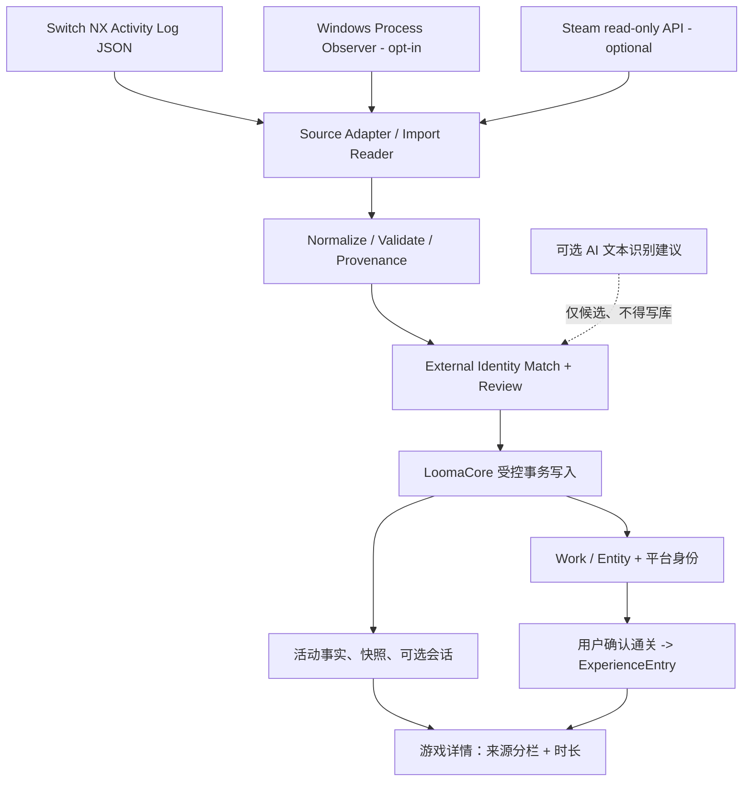

# Looma v0.6｜跨平台游玩事实、个人成就与 AI 识别：架构交叉讨论 RFC

> **文档版本**：RFC v0.1 · 2026-11-15  
> **阶段**：代码调查、可行性验证和反方评审；**本轮禁止直接实现全部功能**。  
> **参考基线**：用户提供的 v0.5 交付报告，提交链 `0cb44b4 → 17b5f30 → 9fa555e → 4b334de → 0be849a → 75eb31a`。开始前请 Antigravity 以本地 `git rev-parse HEAD` 重新确认实际基线。  
> **读者**：本地 Antigravity、用户与 GPT；这不是数据库迁移指令或自动批准的开发任务。

---

## 0. 讨论目的：解决真实生活场景，而不是再堆三个独立子系统

Looma 现已具备 Work（作品身份）、Asset（引用文件）、Experience（个人经历）、Memory（手记）、Relation、Timeline、Reference Mode、MCP 等底座。

现在要解决的问题从“文件在不在”发展为：

- **Switch 1**：游戏记录在自制系统中，Looma 怎样知道我玩过什么、玩了多久？玩通关后能否几乎不操作？
- **PC**：既有 Steam 游戏，也有无 Steam 记录的独立游戏、模拟器和其他发行形式。怎样记录真实游玩时间而不误判？
- **成就**：官方平台解锁、自己记录的里程碑、实际通关应该如何区分？
- **AI 识别**：文件夹名混乱、未知 EXE、媒体或项目文件可以借助外部 LLM 解释；但某些 Gemini 网页反代只具备不稳定的文本/JSON 输出，Tool Calling/Tool Response 不可靠。
- **最终体验**：Looma 中同一款作品应该只有一个可认知的档案，允许按设备/平台查看来源；不能每次同步都新建 Work，也不能把“玩了 100 小时”当作“已通关”。

**本 RFC 的中心假设**：v0.6 首先需要一个可靠的 `ExternalActivitySource → Preview/Normalize → Identity Match → Confirm/Import → Work/Activity/Experience` 链路；AI 分析可作为辅助，不能成为同步的前置依赖。

**希望反重力推翻这条假设（若有代码和成本证据）**，不要为了迎合文档而全盘赞同。

---

## 1. v0.5 的接受情况与需要隔离处理的尾项

### 1.1 已报告完成，不等于全部工况已独立复验

用户提供的 v0.5 交付报告称：112 项 Rust 测试、前端 TypeScript 检查及 Release 构建成功；提交链如文档顶部。源码公开仓库也能看到 `75eb31a` 对 Timeline 与 Sidebar 的实际提交。

**不要为了研究 v0.6 重新全面重构 v0.5**。但在讨论报告中必须说明下列四个尾项当前 HEAD 是否已完全解决，否则另开一个不阻挡 RFC 的 v0.5.1 小补丁：

1. `crates/core/src/facade.rs::update_entity`：读取现有 Work 数据并验证提交类型后，是否依然允许通过通用接口覆盖**合法但过期的** `properties.work`？是否有版本号/CAS/字段 Patch 保护？请给出真实两进程或并发写测试。
2. `get_asset_thumbnail`：是否真的有有界队列/像素限制/并发上限/任务去重？检查是否直接 `image::ImageReader::decode` 全图、再 `thumbnail`；仅使用前端 `` 并不等于限制 Rust 解码并发。
3. `AssetsView` 等页面是否仍存在 catch → `null` 的 `safeInvoke`？App 层的错误 Toast 是否覆盖子组件的失败分支？
4. **资产库可浏览总量**：目前 `App.tsx` 请求首批 `filter: {limit: 50, offset: 0}`，但 `AssetsView.tsx` 接收 `assets: Asset[]` props 并执行 `assets.filter(...)`，没有实际查询下一页的调用；因此数千文件可能只能浏览前 50 条。请在隔离 Vault 导入至少 200 个文件，验证资产库的分页、筛选和总数。全局搜索能够找到第 200 个，不等于资产列表能够正常浏览。

还请确认 `App.tsx` 的 `list_assets` 调用是否使用 `{ filter: { limit, offset } }`，而不是旧式顶层 `{ limit, offset }`。**必须以本地实际 HEAD 为准**；公开网页的抓取缓存可能落后。

### 1.2 进入 v0.6 讨论的门槛

- [ ] 交付报告与真实 HEAD 一致，`cargo test --workspace` 和 `pnpm ... tsc --noEmit` 仍通过；
- [ ] 导出备份并成功恢复至**隔离测试 Vault**，能读取 Work + Experience + SourceRoot；
- [ ] 若发现 P0 写入覆盖或数据一致性漏洞，独立登记 v0.5.1 修复；不要混入新 Activity Schema。

---

## 2. 范围与优先级：建议把 v0.6 定义为“游戏活动接入闭环”

| 能力 | 用户价值 | 建议阶段 | 态度 |
|---|---|---|---|
| Switch NX Activity Log JSON 手动导入 | 高；首先解决已有设备游戏记录 | v0.6 MVP | **优先** |
| Work 同一身份跨设备匹配、去重与审核 | 极高；避免污染档案 | v0.6 MVP | **必要** |
| 累计时长/首次最近游玩/启动次数展示 | 高；由来源提供的事实 | v0.6 MVP | **必要** |
| 一键通关/里程碑确认，形成 Experience | 极高；这是 Looma 的个人档案价值 | v0.6 MVP | **必要** |
| Windows 游戏进程计时 | 中高；不依赖平台 | v0.6 可选第二包 | 先做低侵入 PoC |
| Steam 官方只读时长/成就同步 | 中高；依赖权限与网络 | v0.6 可选第二包 | 先做可行性/隐私评审 |
| Switch 家庭局域网半自动读取 | 高；减少 SD 卡操作 | v0.6.x | 仅在 JSON 链路验证后 |
| 可选 AI 文本 JSON 游戏识别 | 高；解决乱命名 | v0.6.x | 先定义抽象与兼容探针 |
| Switch 常驻插件/系统模块、任意游戏存档推断通关 | 风险高 | 未来独立探索 | **不纳入 MVP** |
| 通用模拟器插件、成就全平台聚合榜、原文件云同步 | 成本高 | 未来 | **不纳入 MVP** |

**为何不把 PC 进程监控和 AI 同时列为必选 P0？** 因为最容易做错的不是请求模型，而是 **多源身份与累计时长的去重语义**。先做 Switch 可复验导入，后续的 Steam/Windows/AI 可共用底层。

---

## 3. 四种不同的“事实”，绝不可混为一个字段

1. **作品是什么**：`Work / Entity`，是跨平台的主身份。类似《某款游戏》这一作品概念，保留别名与版本差异。
2. **某来源说我玩过多久**：`PlaytimeSnapshot / ActivityFact`，带来源、用户、设备、采集时间、证据质量；不是不可争议的真值。
3. **具体什么时候启动/停止游戏**：`PlaySession / Event`，只有来源真正提供且可靠时才存；不能从单个累计时长凭空补出历史会话。
4. **我确认自己通关/达成重要事情**：现有 `ExperienceEntry`，是个人经历。游玩统计或 Steam 成就不能默认替代它。

**反例：** Steam 累计 120 小时、Windows 进程计时 30 小时，不能默认显示为 150 小时。两个记录可能覆盖同一时间段。

**反例：** Switch 没有一个面向所有游戏的统一官方成就系统，因此不能把 Switch 游玩记录导入后自动制造“已解锁成就”或“已通关”。

**反例：** Windows EXE 存活 3 小时，不一定是 3 小时有效操作：可能挂机、睡眠、启动器进程、游戏崩溃未退出，或模拟器进程里切换了多个 ROM。

---

## 4. 待讨论的体系结构（不是最终 Schema）



边界：

- Source Adapter 只读外部输入，不执行修改 Switch 日志、Steam 数据、游戏文件、存档或原始媒体。
- Normalize 层是纯函数/强校验，不应通过字符串猜测直接绑定 Work ID。
- Match 层可给出 `exact / likely / ambiguous / none`，但用户已经拒绝过的映射不能被自动恢复。
- `LoomaCore` 仍为唯一业务写入门面，MCP、CLI 和 Desktop 不得绕过。
- 整次导入要有预览、审计、幂等、部分失败的明确行为；默认不新建数百个未经确认的作品。

### 4.1 建议讨论的领域对象

这些对象仅用于讨论，**请先核对现有 WorkMetadata / ExternalReference / Asset / Relation / Experience 能否承载，不能马上新增 6 张表**。

| 概念 | 最小字段候选 | 作用 |
|---|---|---|
| `ActivitySource` | id, kind, device_label, user_scope, enabled, last_sync, capabilities | 来源管理；同一台 Switch 可以有多个本机用户 |
| `ExternalGameIdentity` | work_id, source_id, namespace, external_game_id, edition_hint, verified_by_user | `switch:title_id`、`steam:appid`、`pc:executable` 与 Work 关联 |
| `ImportBatch` | source_id, format_version, source_export_time, file_sha256, imported_at, summary, errors | 幂等重导与可追溯 |
| `PlaytimeSnapshot` | source_user, external_game_id, cumulative_seconds, launches, first/last, captured_at | 保存来源报告的累计值，防止重复加总 |
| `PlaySession` | external_session_id?, start, end?, duration?, precision, confidence/source | 仅在有记录时使用；未结束/睡眠需标记 |
| `AchievementFact` | namespace, game_id, achievement_key, unlocked, unlocked_at?, source_user, provenance | 官方成就事实；与个人 Experience 不混淆 |
| `ImportMatchSuggestion` | external_id, candidate_work_ids, reasons, decision_status | 匹配建议与人工复核队列 |

建议把数据来源字段建成可扩展字符串/枚举，但不创造一个过度泛化的“万能 Connector SDK”。

### 4.2 推荐最小内部接口（讨论用）

```rust
// Pseudocode: concrete types / trait placement should be decided after code inspection.
trait ActivityImportAdapter {
    fn probe(&self, input: &Path) -> Result<SourceProbe>;
    fn preview(&self, input: &Path) -> Result<ImportPreview>;
}

impl LoomaCore {
    fn preview_activity_import(&self, source: SourceId, input: &Path) -> Result<ImportPreview>;
    fn commit_activity_import(&self, actor: &str, approved: ImportDecision) -> Result<ImportOutcome>;
    fn list_work_activity(&self, work_id: &str) -> Result<WorkActivityView>;
}
```

要求：Preview 阶段**不写业务表**；若确需记录导入历史缓存，须是可丢弃 staging，不改变 Work 与 Experience。提交前再次校验源文件指纹和映射决议，避免预览后文件被替换。

---

## 5. Switch 1：以 NX Activity Log JSON 作为第一个外部样例

### 5.1 已核实的可用能力

NX Activity Log 官方仓库与导出 Wiki 显示：JSON 顶层包含 `exportTimestamp`、`exportVersion`、`users`；用户下有 `id`、`name`、`titles`；作品下有 `id`（Title ID）、`name`、`summary.firstPlayed`、`summary.lastPlayed`、`summary.launches`、`summary.playtime`（**秒**）以及 `events`（`clockTimestamp`, `steadyTimestamp`, `type`）。

原始资料：
- https://github.com/tallbl0nde/NX-Activity-Log
- https://github.com/tallbl0nde/NX-Activity-Log/wiki/Exported-JSON-Format
- https://github.com/tallbl0nde/NX-Activity-Log/releases

**不要由文档里随手编造的 JSON 就宣称解析器兼容。** 请调查实际导出版本、真实格式的空值、整数边界、时间格式、不同账户、Title ID 的数据类型和重复/缺失事件。

### 5.2 建议的 MVP 用户旅程

1. Switch 使用者在 NX Activity Log 中执行导出，复制 JSON 至 PC；不要求拆机、不改固件、不要求连接任天堂在线服务。
2. 在 Looma 游戏页打开 **“同步游戏记录”**，选择“Switch · NX Activity Log JSON”。
3. Looma 展示“来源用户/导出日期/发现 N 款游戏/可能与现有作品重复 M 项/可导入时长范围”，**只预览不更改**。
4. 同一 Title ID + Switch 用户标识首先匹配过去确认的映射；新条目再通过名称/别名找候选。模糊匹配进入人工确认，不自动创建两份同名 Work。
5. 用户确认映射后，Looma 更新来源快照与游戏详情“Switch”分栏；再次导入相同 JSON = 幂等无增量。
6. 若想记通关，点击一次“标记已通关”或通过受控 MCP 告诉小满；生成 `ExperienceEntry`。**发生日期可未知**，不会从最近游玩时间强推断。

### 5.3 必须讨论的异常处理

- Switch 一个设备多个 Profile：按用户分开统计，不要无意聚合其他人的游戏时长；可以给本地用户 Profile 自定义显示名称或匿名标识。
- `Title ID` 与 DLC/更新/地区版本关系：不一定等于一款独一无二的作品身份；提供工作映射的人工修正、拆分与合并。
- 导出时间戳异常/主机时间被调整：保留源时间，并标记精度与异常；不要伪造历史。
- 首次同步累计值 80h，二次同样 80h：**仍是 80h**；三次变 83h：新的来源快照是 83h，而不是 `80+80+83`。
- 日志重置导致从 83h 变 2h：不要隐式“取最大值=永远 83h”或“减去 81h”；识别 reset/baseline change，显示异常供确认。
- `events` 完整度不足：只导入 summary，不制造会话；如能提取 sessions，必须明确事件类型、暂停/切回主界面的语义。
- 导出文件里包含多个用户，名字属于敏感信息：预览时明确，并允许只导入一个用户。
- 文件损坏、过大、恶意深度嵌套 JSON：尺寸、深度、数目上限与本地校验。

### 5.4 家庭局域网同步的现实边界

**文件传输 ≠ 数据自动导出**。即使可通过家庭局域网访问 Switch SD 内容，也不代表 NX Activity Log 会实时更新 JSON。

请反重力评估：

- A. 手动生成 JSON + 拖入 Looma（零设备驻留，最高可靠性）。
- B. 手动生成 JSON + PC 通过局域网读取文件（减少 SD 卡操作）。
- C. 需要额外 Switch 端驻留或主动导出组件（成本/稳定性/隐私较高，后续探索）。

首次 PoC 必须停在 A；可用再评估 B。不要为这个功能提出修改 Switch 系统模块、直接读写内部 playlog 数据库或在公网暴露端口的方案。

---

## 6. PC 游戏：记录“启动运行”不是绝对的“有效游玩”

反重力 v0.5 报告提出 Windows 进程监测作为非 Steam 游戏游玩时长来源，可行性值得研究，但“只要 EXE 运行就能**准确**统计时长”的表述过强。

需要评估以下策略：

| 方案 | 优点 | 隐患 | 建议 |
|---|---|---|---|
| A. 由用户手动点击开始/结束会话 | 数据可解释、可校正 | 需要额外操作 | 作为可靠兜底 |
| B. 进程启动/退出观测 | 兼容多数无平台游戏 | 启动器、挂机、睡眠、进程重启、模拟器同 EXE 多游戏 | PoC 首选 |
| C. 观察活跃窗口 + 进程 | 可减少明显挂机误差 | 焦点切换、多显示器、控制器、全屏行为 | 可选增强 |
| D. 读取内存/注入游戏进程/Hook | 可能更精确 | 风险与兼容性高 | **明确排除** |

建议：

- 观察器默认**关闭**，可按游戏启用；无需管理员、无需注入、不得破坏游戏进程或反作弊保护。
- 绑定明确 `ExecutableIdentity`：真实路径/相对 SourceRoot/进程映像名的组合，而不是仅按同名 `game.exe`。
- 模拟器（如 Switch/PS/其他）通常一个宿主 EXE 运行多个不同游戏，不能仅凭模拟器进程把时间算到某款游戏；需要额外可用元数据或人工选择。
- 系统睡眠/休眠、崩溃、意外退出、跨日、时钟被改、进程 PID 复用、后台窗口、多个实例均需用例。
- 本机计时结果标注 **“检测到进程运行 X 小时（估算）”**，不要伪装为平台官方游玩时长。
- 数据导出、删除与停用都要简单；不要强制 Windows 开机自启。

### 6.1 合并多个来源的时长

**不应默认把 Steam 累计时长、Windows 观察器计时和 Switch 累计时长无条件求和。**

建议展示：

- Switch: 来源累计 42.3h；导入自日期、用户、设备。
- Steam: 来源累计 60h；最后同步日期。
- 本机观测: 已观测 12.8h；覆盖时间区间，可能与 Steam 重合。

跨设备总和（PC + Switch）仅当来源独立且去重规则已明确，才能作为“估算总游玩时长”；否则只展示各来源或指定主来源。

---

## 7. Steam 与成就：来源可信，但能力和隐私有约束

官方文档显示：`IPlayerService/GetOwnedGames` 可获取在可见范围内的拥有游戏与游玩统计；`ISteamUserStats/GetPlayerAchievements` 可读取指定 app 的成就。可用性取决于接口权限、账号隐私、API 凭据等条件，不可默认任意 Steam ID 直接公开获取。

资料：
- https://partner.steamgames.com/doc/webapi/IPlayerService
- https://partner.steamgames.com/doc/webapi/ISteamUserStats

建议研究：

1. 账号连接方案：Steam 公开资料导入 vs 官方只读 API；**不能把用户密码或 API Key 明文放在 Vault 导出**。
2. `appid` 到 Work 的映射是否需要区分重制版、合集、DLC、演示版。
3. Steam 的累计游玩与本机观察器可能重合；不要重复累计。
4. 已解锁成就来源、解锁时间、语言名称与图标是否完整；不可因 API 暂时不可读就把已记录成就清空。
5. **官方成就事实** vs **用户自定义打卡** vs **Experience 通关里程碑** 三者必须可解释地共存。
6. Switch 无通用官方成就接口；个别游戏存档/内置系统不属于通用成就源。
7. 本地非官方游戏：不要尝试扫描所有补丁目录来“猜”成就；先支持用户自定义里程碑与手动通关，未来需要真实解析样例才考虑专用插件。

**不得编造官方解锁记录**。成就显示必须有 `provider + external_game_id + achievement_key + timestamp/unknown + imported_at`，并明确“来自平台”还是“手动记录”。

---

## 8. 可选 AI 识别：不要走 Tool Calling 链，不要授予写数据库权限

### 8.1 建议的能力分层

```
Local Rules (folder / exe / metadata / current Works)
      -> unresolved candidates only
      -> AI Analysis Provider (optional)
      -> JSON text / schema output
      -> local validator + provenance
      -> matching review / manual confirm
      -> LoomaCore commits approved identity
```

第一版仅有 `identify_game_from_metadata`，不要一次做成全媒体智能助手。

### 8.2 为什么兼容 Gemini 网页版反代

模型分析采用**单轮纯文本输出**即可，不依赖工具消息回传。

分档能力探测：

- `json_schema` 输出稳定时优先使用；
- 反代不支持时退化为普通 JSON 文本；支持容错提取但**不得无校验接受**；
- 输出非 JSON、幻觉、HTTP 失败、限流、超时 -> 有界重试 + 人工处理/纯规则回退；
- 反代 Provider 的功能、支持的模型与服务条款需独立核验；不得假定网页版反代兼容官方 Gemini API 全部特性。

### 8.3 需要 Antigravity 回答的架构选择

- A. Looma 完全不直接连 LLM：MCP `list_unidentified_candidates` → 外部 Antigravity/DSH 分析 → `submit_analysis_suggestion` → 审核。
- B. Looma 有可选的 OpenAI-compatible / Gemini Provider：用户点“识别游戏”，调用文本 API 并产生待审核建议。
- C. 同时支持 A、B，但共用 **Suggestion + Review Queue**，不维护两套入库路径。

**初步偏向 C 的数据契约，但 MVP 先实现 A 或 B 之一**，以最少工作验证真实价值。

### 8.4 隐私/预算规则

- 默认关闭网络 AI；必须明确显示将要发送的资料。
- 默认不发送完整路径、用户名、存档、源码、配置密钥、私密截图、音频、原始媒体；发送文件夹末段名称、EXE 文件名等最小摘要。
- 不能把扫描几十万文件自动变成几十万次 API 请求；本地规则、缓存与批量审核优先。
- AI 只能输出建议：`suggested_title`、`aliases`、`possible_edition`、`evidence`、`uncertainty`；模型不得自行生成或选定数据库 `work_id`，最终匹配应由 Core 决定并可人工纠正。
- 识别低置信或冲突时，不猜测具体版本、DLC、发行平台；不修改原文件。

---

## 9. 真实可用的 UI 应该是什么样

**不要新增 3 个一级入口叫“Switch 同步 / PC 时长 / AI”。** 用户已经有作品与游戏页；把能力放在原有游戏档案里。

建议入口：

- 游戏库右上 **“同步游戏记录”**：选数据源（Switch JSON / 未来 Steam / PC）。导入预览先列未匹配项，可选择“链接已有作品 / 新建作品 / 跳过”。
- 游戏详情增加 **“游玩记录”**：按平台与来源显示时长、首次/最近游玩、数据新鲜度；官方/估算/手动使用不同标签；支持查看原始来源。
- 同一详情中仍使用原 `Experience` 的 **“记录通关/二周目/里程碑”**；不强制填写准确日期。
- 活动历史默认**不把每次游戏启动**都刷进个人时间线；个人 Timeline 优先展示通关与自己明确收藏的里程碑。所有启动活动在详情或系统轨道可查。
- 在设置页放数据源配置、AI Provider、隐私与同步状态；外部账号密钥与本地缓存不进入普通导出。

---

## 10. 具体需要反重力按源码回答的 18 个问题

> 回答每项需 `文件路径 + 函数名/行号 + 当前行为 + 是否已有可复用 API + 方案 A/B + 真实风险`；不能只有“可行，推荐抽象成 Service”。

### 领域/持久化

**Q01.** `WorkMetadata` 是否已有平台、Playtime、External IDs、Progress 字段？哪些是单值状态，哪些是可扩展集合？如果写入 `properties.work` 是否会触发旧数据语义问题？

**Q02.** `ExternalReference` 是否适合存 `switch:title_id` / `steam:appid`？如果不适合，原因是 URI 定位还是唯一性/用户维度缺失？

**Q03.** `ExperienceEntry` 的 `event_type` / 日期精度 / `context_json` 能否无破坏地容纳“Switch 通关”的来源与平台？新一次同步是否可能误写重复 Experience？

**Q04.** 当前 Backup/Restore 是哪些表/集合的显式快照？新增数据时哪些枚举、迁移、校验和/导出契约必须同步修改？

**Q05.** 现有 Core 是否支持在单一事务中完成：更新映射 + 保存累计快照 + 审计 + 非必需 Experience？如果不支持，最小可行边界是什么？

### Switch 导入

**Q06.** 验证 NX Activity Log `Exported JSON Format` 与最新应用导出的实际差异；空 `events`、同 Title ID 多用户、`playtime` 秒、大小整数、错误时钟如何处理？提供**脱敏 JSON 夹具**与解析表。

**Q07.** Switch 用户标识如何私密地映射至 Looma 的本地 Profile？导入别人机器导出文件是否需要隔离，而非默认为自己？

**Q08.** 同一文件导入两次、累计时长变小、设备 Profile 切换、同名不同 Title ID，正确结果分别是什么？设计幂等与冲突测试。

**Q09.** 本地 SourceRoot + JSON 手动读取、局域网文件读取有何复用空间？是否真的有成熟、稳定且安全的主动 JSON 自动导出机制？没有证据不得提出无人值守承诺。

### PC、Steam、成就

**Q10.** 最小 Windows 用户态游戏计时 PoC 是 Windows API、WMI 还是自带进程库？如何处理恢复睡眠、后台挂机、意外退出和同名 EXE？给出性能/故障和隐私分析。

**Q11.** 非 Steam 游戏与模拟器如何对应 Work？不能将 `yuzu.exe`、`ryujinx.exe` 或其他模拟器进程全算在一款作品下。

**Q12.** Steam 只读拉取是否能在用户可用的凭据、隐私设置下真正拿到游玩时间和成就？别把合作伙伴 API 与普通用户身份权限混淆；给出最小手动验证步骤和失败回退。

**Q13.** 不同来源游玩时长有重叠时，Work 详情按什么规则显示？是否存快照原值并避免自造单一“准确总时长”？

**Q14.** “成就/打卡/通关”如何共存于游戏详情而不出现三个重复的 `completed` 状态？官方解锁与用户手动打卡能否明确追溯？

### AI / 用户体验 / 运行安全

**Q15.** 现有 `intelligence` crate 与 `suggestion` 结构能否复用给 AI 分析，还是其原有建议语义不适合？需避免把未经验证 LLM 输出写入 Work。

**Q16.** DSH/Antigravity 使用现有 MCP 能否完成只读候选拉取与审核建议写入？`MetadataWrite`/`ContentWrite` 等权限层级如何设计？AI Provider 不需要 Tool Calling 是否可通过模拟反代进行探针验证？

**Q17.** UI 最少改哪些组件（`GamesView`, `WorkDetailDrawer`, `ExperienceModal`, `SettingsView`）？怎么在没有任何数据源时仍保持干净？

**Q18.** 迁移升级、恢复旧 Vault、多源并发导入、输入 JSON 极大/恶意格式、敏感设备/账号信息泄漏，分别需要哪些自动化和真实 UI 用例？

---

## 11. 反方评审：请认真反驳以下主张

1. **“做一个万能 ExternalActivitySource 就行”**：是否过度抽象？Switch JSON 和 Windows 进程观察器的时间语义完全不同，是否应先做简单 ImportService + Adapter 后再抽象？
2. **“都放 WorkMetadata 一个 JSON 字段最省事”**：在高频时长与会话记录下，会不会放大并发覆盖与备份差异？
3. **“AI 可自动识别所有游戏”**：有无公开数据证据？离线模糊名称匹配能覆盖多少？AI 无网络搜索时可能只靠常识编造标题。
4. **“进程启动就是游戏时间”**：是否有睡眠、挂起、模拟器与误匹配陷阱？如何给用户明示估算？
5. **“累计时长直接相加”**：多来源重叠和 reset 应如何处理？
6. **“做完 Steam 成就就等于所有平台都能同步成就”**：Switch 与离线游戏明显不成立，怎样合理缩小需求？
7. **“直接让小满/AI 自动标记 Completed”**：如果只有近期时长变化，没有通关证据，是否必须询问用户？

反方观点应附具体验收失败实例，而不是泛泛“有风险”。

---

## 12. 必须完成的原型试验（本轮不允许落入真实 Vault）

### PoC-A：Switch JSON Parser + Match Preview（最高优先）

- 使用公开格式构造正向/异常夹具，若能获得用户脱敏真实 JSON 更好，但本轮不要求用户交出隐私文件。
- 只运行解析与预览，不写业务数据库、不创建 Work、不更改 Switch 文件。
- 验证 1/2/多用户、0/数百款、重复导入、时钟异常、累计值归零、同名不同 ID、首次/最近时间空值。
- 输出“可自动确定 X 项 / 待用户确认 Y 项 / 拒绝 Z 项”，注明这是测试夹具统计，不是对用户库的实际结果。

### PoC-B：PC 进程计时策略基准

- 隔离测试进程；模拟启动、退出、休眠恢复、重启、意外终止、同名不同路径。
- 不读取游戏私有内存或注入、无需管理员权限，不扫描真实用户敏感进程日志。
- 输出偏差范围、CPU/内存占用和错误状态，验证“仅观察，不行动”。

### PoC-C：AI 反代兼容性假设实验

- 用 Fake Provider 模拟：纯文本 JSON / Schema JSON / Markdown 包裹 JSON / 错误 JSON / 429 / 超时 / 断流。
- 用可配置的真实 Endpoint 再做**显式用户授权**下的冒烟测试，禁止将 API Key 写入日志或仓库。
- 以 JSON Schema 本地验证为准，模型结果永不越过 Review Queue。

### PoC-D：来源重叠与幂等回放

- 对同一 Work 人工构造 Steam 60h、Windows 10h（重叠）、Switch 42h、连续 3 次相同 NX JSON；验证不会被合并成错误的 60+10+42 或三次累加。
- 比较选择不同来源展示策略时的可解释性、撤销和恢复操作。

---

## 13. 候选路线图（交叉讨论后才定稿）

| 建议包 | 目标 | 明确不做 | 准入标准 |
|---|---|---|---|
| `v0.5.1` | 只修已证实的资产库分页闭环/并发覆盖/缩略图有界/错误可见性问题 | 不做新 Activity Schema | 已复现且有回归测试 |
| `v0.6-R0` | 导入基础契约、来源登记、身份审核、备份契约 | 不接 Steam/AI | 选定最小数据结构 |
| `v0.6-R1` | Switch NX JSON 离线导入、幂等、Work 映射、时长展示 | 不做自动远程连接 | 脱敏真实或规范测试夹具通过 |
| `v0.6-R2` | 通关快捷确认 + Experience；PC 计时实验或 Steam 只读先取一项 | 不自动推断通关 | 用户可在同一作品详情完成 |
| `v0.6-R3` | 最小 AI 识别建议或扩展活动来源（根据成本选择） | 不建内置 Agent | 提供 PoC 和人工审核 |
| `v0.6.x` | 局域网半自动读取、进程观察器稳定化、官方成就 | 不开放公网、无侵入式 Hook | 真实设备验证 |

注：这张表是**讨论假设**而非硬性工期。反重力可以提出更少阶段或改变顺序，但须证明收益、成本与数据风险。

---

## 14. 输出格式：反重力下一轮必须交付什么

本轮请创建 **`docs/Looma_v0.6_Activity_AI_Architecture_Discussion_Response.md`**，不少于以下内容：

1. **HEAD / 状态**：实际 SHA、dirty 状态、核心模型、Core 门面、Migration、备份版本、当前平台编译情况。
2. **v0.5.1 尾项复核**：上列四个风险是否属实，真实函数与测试证据；有则独立建议修复，不要混进 v0.6。
3. **Q01–Q18 逐条答复**：每项有路径、函数、证据、当前限制、方案比较。
4. **Switch JSON 实际格式调查**：外部文档与版本证据、解析边界、导入与多用户语义。
5. **PC/Steam/成就与 AI 比较**：可行路径、隐私与 API 限制、交互成本、失败回退。
6. **领域模型两案**：最小 SQL 变更版 vs 拓展通用活动层版，表/索引/唯一约束/迁移/备份影响与反方评审。
7. **交互原型文字稿**：用户第一次导入 Switch JSON 的逐步操作、重复导入、手动标记通关。
8. **PoC 与测试**：能运行的纯解析器或独立测试夹具优先；本轮不准修改生产业务表、真实 Vault、现有 Migration。
9. **优先级与延期清单**：真正值得 v0.6 第一阶段做什么、什么不值得做、阻断因素及未知项。
10. **请直接给出有分歧的结论**：不强求同意本 RFC；需要用户选择的决策控制在 3 项以内。

**特别要求**：严格区分“源码已证实”“外部资料支持”“PoC 验证通过”“仅是假设”。切勿用“100% 完全准确”“全平台成就自动同步”等无法成立的表述。

---

## 15. 最终设计价值观

> Looma 不该要求用户有一台 Switch、一台 PC 就维护两套游戏清单。  
> Looma 也不该让“游戏已经启动过”自动变成“我通关了”。  
> 正确的做法是：**自动收集可验证的事实，帮助识别模糊的内容，把个人意义的最终决定留给用户。**

*本轮讨论完成后，再由 GPT 和用户裁定具体 v0.6 实施范围与最终架构。*
