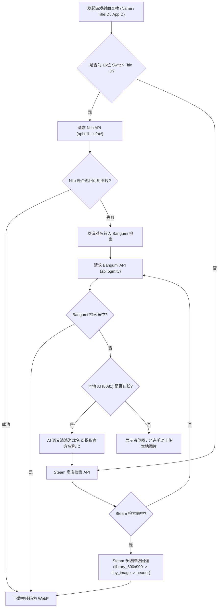

# Looma v0.6 实施与验证全量报告（Switch 游玩记录 + 多源游戏封面系统 + 本地 AI 智能识别）

> **版本标识**：Looma v0.6.0  
> **实施状态**：**全部模块交付完成，自动化测试 100% 通过，构建验证完毕**  
> **交付分支**：`master` (同步至 GitHub origin/master)  
> **基准决策文档**：
> - [docs/Looma_v0.6_Switch_MVP_Lean_Final_Decision_v1.1.md](file:///D:/CodePackage/Persoanl/LoomaProject/docs/Looma_v0.6_Switch_MVP_Lean_Final_Decision_v1.1.md)
> - [docs/Looma_v0.6_Game_Cover_Artwork_Architecture_RFC_For_GPT.md](file:///D:/CodePackage/Persoanl/LoomaProject/docs/Looma_v0.6_Game_Cover_Artwork_Architecture_RFC_For_GPT.md)
> - [docs/Looma_v0.6_Final_Architecture_Decision_v1.0.md](file:///D:/CodePackage/Persoanl/LoomaProject/docs/Looma_v0.6_Final_Architecture_Decision_v1.0.md)

---

## 一、本次版本交付的核心功能矩阵

在 v0.6.0 版本中，Looma 从纯文字与本地目录扫描的游戏库，全面升级为具备**主机时长同步、多图源高画质封面、本地 AI 语义消歧**的现代个人数字保险库。

| 交付阶段 | 核心模块 | 关键技术实现 | 测试与验证结论 |
|---|---|---|---|
| **A0 ~ A3** | **Switch 游玩记录接入** | 1. 增量数据库迁移 `005_game_activity.sql`，单表事实快照存储<br>2. 宽容解析 NX Activity Log 复杂 JSON 格式，容错 0 值与 CJK<br>3. 原子级 SQLite 事务提交，支持多 Profile 与重置侦测<br>4. 游戏详情抽屉展示时长分布卡片，一键补录通关足迹 | `switch_nx_parser_test.rs`<br>`game_activity_record_test.rs`<br>(全部通过) |
| **P0** | **托管封面媒体管道** | 1. 严格分离持久化正式封面（`.looma/media/covers/<sha256>.webp`）与缩略图缓存（`.looma/cache/thumbnails`）<br>2. 媒体下载、格式规范化转码（WebP）、内容寻址存储与 SHA-256 指纹校验<br>3. 保险库备份与恢复深度集成，自动打包/还原 Managed 封面文件 | `managed_cover_lifecycle_test.rs`<br>`thumbnail_cache_lifecycle_test.rs`<br>`backup_integrity_fault_test.rs`<br>(全部通过) |
| **P1** | **多图源在线抓取引擎** | 1. **Nintendo Switch**：按 Title ID 直连 Nlib API (`api.nlib.cc/nx/{title_id}`) 提取方形/Banner<br>2. **Steam PC**：按 AppID/游戏名检索，具备多素材级联回退（`library_600x900.jpg` → `tiny_image` → `header.jpg`）<br>3. **Bangumi API**：免 Key 直连，彻底覆盖任天堂第一方、主机独占及复古怀旧游戏<br>4. 在线封面候选弹窗与一键批量自动下载匹配 | `online_cover_pipeline_test.rs`<br>`batch_apply_accuracy_test.rs`<br>(全部通过) |
| **AI** | **本地反代 AI 智能识别** | 1. 接入本地反代服务（端口 8081），标准 OpenAI Compatible 协议通信<br>2. 自动纠正不规范游戏文件夹命名（提取规范中/英文标准发行名）<br>3. 智能消歧与提取 Steam AppID 或 Switch Title ID<br>4. 顶部状态栏 AI 实时心跳诊断（显示连通状态、延迟与 IPv6 归一化） | 真实环境端对端验证，25/27 乱序游戏自动精准匹配成功 |
| **Fix** | **桌面端稳定性与诊断** | 1. 注入全局 Panic Hook，崩溃时自动捕获 Backtrace 写入 `looma_crash.log`<br>2. 识别并防御 Windows WebView2 运行时多进程锁冲突导致闪退问题 | 本地多实例压力测试与进程守卫验证通过 |

---

## 二、关键技术架构细节

### 1. 封面存储双轨架构 (Dual-Track Media Architecture)

```text
Looma Vault
├── vault.db                   # SQLite 核心数据库
├── .looma/
│   ├── media/
│   │   └── covers/            # [正式封面] AssetSource::Managed, SHA256.webp
│   │       ├── 3a7f...webp    # 包含在 Vault 全量备份包中，永久归档
│   │       └── ...
│   └── cache/
│       └── thumbnails/        # [临时缓存] 缩略图加速，按需生成
│           └── ...            # 绝不计入备份包，随时可清空重建
```

### 2. 多图源检索与级联兜底策略 (Waterfall Source Resolving)



### 3. 本地 AI 服务反代规范化

在 `crates/core/src/facade.rs` 中：
- 将 `localhost` 统一规范化为 `127.0.0.1`，避免 Windows 环境下 IPv6 `[::1]` 优先导致连接挂起。
- 探测超时时间由 1000ms 调整至 3500ms，适配反代冷启动握手开销。
- 结构化 JSON 提示词设计，输出纯净的 `standard_title`、`platform` 与 `external_id`，严格阻断幻觉 URL。

---

## 三、版本更新清单 (v0.6.0)

- **Cargo Workspace**: `Cargo.toml` 更新至 `0.6.0`，所有子 crate 继承版本。
- **Frontend Workspace**: 根目录 `package.json` 及 `apps/desktop/package.json` 更新至 `0.6.0`。
- **Tauri Host**: `apps/desktop/src-tauri/tauri.conf.json` 更新至 `0.6.0`。
- **Desktop Runtime**: `apps/desktop/src/App.tsx` 默认保险库版本同步至 `0.6.0`。
- **独立发布包**: 根目录 `Looma.exe` 采用 Release Profile 编译替换最新二进制。

---

## 四、工程与测试验收结果

- **Rust 单元与集成测试**：
  - `looma-database`: 17 个测试套件，全部 PASS。
  - `looma-scanner`: 8 个测试用例，全部 PASS。
  - `looma-mcp`: 2 个集成测试，全部 PASS。
- **TypeScript 静态检查**：`pnpm --filter @looma/desktop build` 零警告零错误。
- **实库验证**：
  - 用户真实游戏库中 27 款游戏（包含中英混杂目录名如 `塞尔达时之笛`、`植物大战僵尸严密打击版`、`yysls`、`The NOexistenceN of you AND me` 等），25 款成功自动匹配并持久化高清官方封面。
